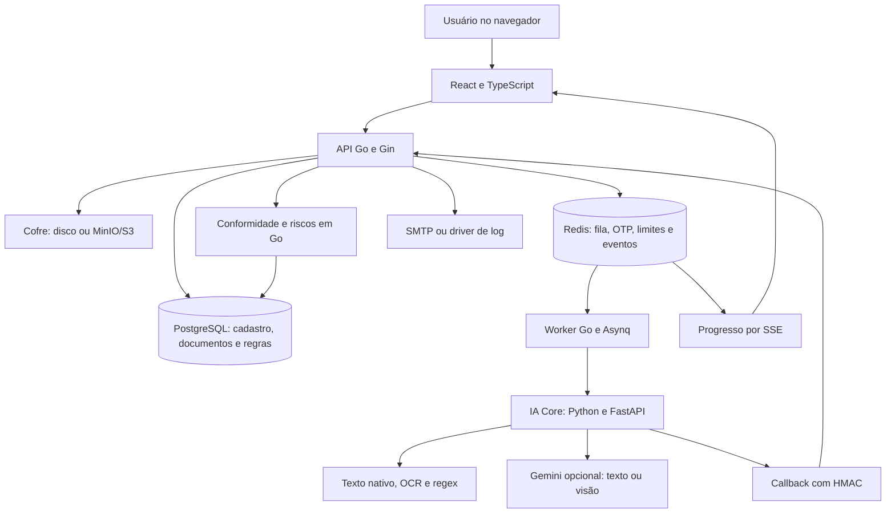
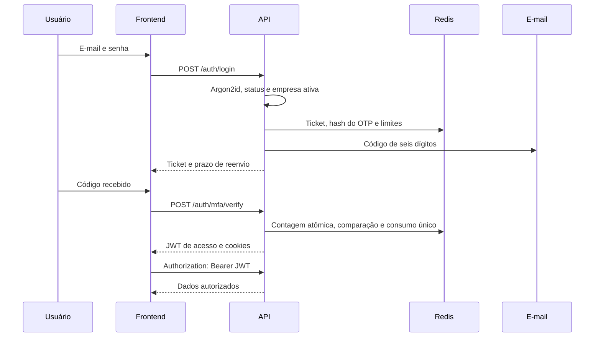
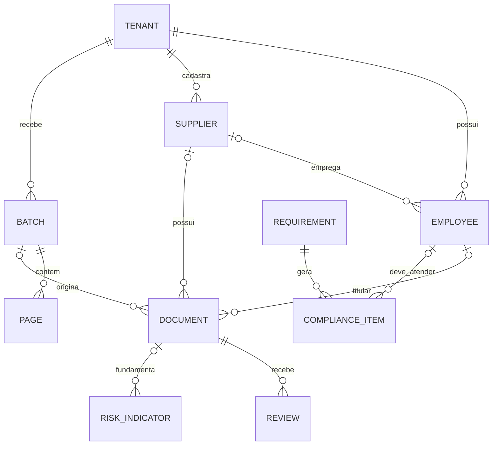

# Citadel IA — especificações do sistema e guia para a banca

**Data da análise:** 6 de novembro de 2026.  
**Referência Git:** `a5a6b84`, acrescida das alterações locais presentes durante a leitura, inclusive os arquivos novos de fornecedores e do gerador de documentos.  
**Objetivo:** explicar o produto, as funcionalidades, os documentos, os indicadores e a implementação com profundidade suficiente para apresentar e responder perguntas técnicas e de negócio.

Este documento foi elaborado a partir do código disponível no repositório. A análise incluiu inventário e varredura de 152 arquivos de código Go, Python, TypeScript/TSX e SQL, leitura dirigida dos fluxos de negócio, telas, migrações, configurações, infraestrutura e testes. Os PDFs de demonstração foram inventariados pelos manifestos e gabaritos; não houve avaliação visual individual das 696 páginas. Dependências instaladas, arquivos de execução e segredos não integram o inventário de código próprio.

**Como interpretar as afirmações:** “implementado” significa que o comportamento foi encontrado no código; “verificado nesta análise” identifica execução realizada para este documento; “limitação” identifica comportamento parcial, dependência ou ausência. Documentação anterior e textos da interface foram confrontados com a implementação. Não foram consultadas fontes jurídicas nem tabelas comerciais externas: bases legais e custos descritos aqui são os cadastrados no projeto, sem certificação de sua atualidade.

## Índice de estudo

1. [Produto e conceitos essenciais](#produto)
2. [Arquitetura e tecnologias](#arquitetura)
3. [Perfis e permissões](#perfis)
4. [Funcionalidades por módulo](#funcionalidades)
5. [Catálogo completo de documentos](#catalogo)
6. [Campos e extração de dados](#campos)
7. [Fluxo completo de processamento](#fluxo)
8. [Funil de IA e critérios de roteamento](#funil)
9. [Separação e agrupamento de páginas](#separacao)
10. [Vínculos, pré-cadastros e fornecedores](#vinculos)
11. [Revisão humana e versionamento](#revisao)
12. [Motor de conformidade documental](#conformidade)
13. [Checklists e mobilização](#mobilizacao)
14. [Indicadores de risco](#riscos)
15. [Indicadores gerenciais e fórmulas](#metricas)
16. [FinOps: medição e simulação](#finops)
17. [Login, autenticação e sessões](#login)
18. [Segurança, privacidade e auditoria](#seguranca)
19. [Modelo de dados e APIs](#dados)
20. [Operação, infraestrutura e configuração](#operacao)
21. [Testes, demonstrações e evidências](#testes)
22. [Limitações e diferenças entre promessa e código](#limites)
23. [Roteiro de apresentação e perguntas da banca](#banca)
24. [Mapa de arquivos e glossário](#mapa)
25. [Inventário das rotas implementadas](#rotas)

<a id="produto"></a>
## 1. Produto e conceitos essenciais

A Citadel IA organiza documentos trabalhistas e de prestadores em uma plataforma multiempresa. O usuário envia um lote misturado; o sistema transforma o arquivo em páginas, reconhece tipos documentais, extrai informações, tenta identificar o titular e a empresa, organiza dossiês e sinaliza o que precisa de revisão, atualização ou conferência.

O problema tratado é a combinação de arquivos desorganizados, conferência manual, dificuldade para localizar comprovantes e falta de visibilidade sobre documentos ausentes ou vencidos. A plataforma atende à operação de RH/DP e à fiscalização documental de terceirizadas e fornecedores.

**Explicação de 30 segundos para a banca:** “A Citadel IA recebe lotes misturados de documentos trabalhistas, identifica cada documento e organiza os dossiês por pessoa e empresa. Ela combina leitura local e IA multimodal, encaminha dúvidas para revisão humana e cruza os documentos com as exigências configuradas pela empresa. O resultado é uma visão de pendências, vencimentos e sinais de risco, com rastreabilidade das ações.”

### 1.1. Termos que não podem ser confundidos

| Conceito | Significado no sistema |
|---|---|
| Tenant | Empresa cliente, dona do ambiente e do isolamento de dados |
| Unidade | Filial ou unidade operacional da empresa cliente |
| Fornecedor/terceirizada | Empresa identificada por CNPJ dentro de um tenant; não é outro tenant |
| Funcionário | Pessoa cadastrada por CPF, pertencente à própria empresa ou a um fornecedor |
| Lote | Arquivo recebido, que pode conter várias páginas e documentos |
| Página | Unidade visual e de checkpoint do processamento |
| Documento | Grupo de uma ou mais páginas, com tipo, campos e status |
| Dossiê | Visão dos dados, documentos, exigências, histórico e riscos de uma pessoa ou fornecedor |
| Confiança | Pontuação de leitura/classificação, usada para encaminhamento; não é probabilidade de veracidade |
| Aprovação | Estado do documento no fluxo de análise/revisão |
| Conformidade | Atendimento a uma exigência documental configurada |
| Checklist | Conferências feitas sobre um documento específico |
| Mobilização | Resumo do status e do checklist daquele documento |
| Risco | Sinal de triagem gerado por regra; não é cálculo de probabilidade de processo nem parecer jurídico |

### 1.2. Alcance do produto

O código contempla gestão documental e indicadores. Não implementa folha de pagamento, cálculo oficial de encargos, consulta automática ao eSocial/FGTS/tribunais, validação de autenticidade em órgãos emissores ou decisão jurídica automática. Salvar um holerite significa analisar o documento apresentado; não significa confirmar a transação bancária que ele declara.

<a id="arquitetura"></a>
## 2. Arquitetura e tecnologias



| Componente | Tecnologia encontrada | Responsabilidade |
|---|---|---|
| Frontend | React 19, TypeScript 6, Vite 8, React Router 7 | Telas, formulários, navegação e visualização |
| Estado remoto | TanStack React Query 5 | Consulta, cache e atualização dos dados da API |
| Interface | Tailwind CSS 4, Lucide, Recharts 3 | Estilos, ícones e gráficos |
| Formulários | React Hook Form e Zod | Validações de interface, sobretudo autenticação |
| API | Go 1.26 e Gin 1.12 | Autenticação, regras, consultas e integração |
| Banco | PostgreSQL 16, pgx 5 | Persistência, transações, RLS, busca textual e similaridade |
| Filas | Redis 7 e Asynq | Processamento assíncrono e tarefas agendadas |
| IA Core | Python; imagem Docker 3.12; FastAPI/Pydantic | Fatiamento, análise por página, agrupamento e renderização |
| PDF/imagens | PyMuPDF, Pillow e Tesseract em português | Rasterização, texto nativo, OCR e geração dos PDFs |
| IA externa | SDK `google-genai` | Gemini quando configurado |
| Armazenamento | Disco local ou MinIO/S3 | Objetos cifrados pela aplicação |
| Antivírus | ClamAV | Inspeção do arquivo recebido quando configurado |
| Entrega web | nginx e Traefik | SPA, proxy e HTTPS no Compose de produção |
| Exportação tabular | CSV e Excelize | Relatórios CSV/XLSX |

As versões são declarações do repositório, não recomendações externas. O Python do `pyproject.toml` exige 3.11+, enquanto a imagem operacional usa 3.12.

### 2.1. Por que API e worker são separados?

O envio do arquivo não precisa esperar toda a análise. A API recebe e enfileira; o worker coordena o processamento. O navegador acompanha o progresso por eventos SSE. A separação também permite reiniciar o worker e retomar páginas concluídas sem repetir todo o lote.

### 2.2. Onde ficam as decisões?

| Decisão | Local |
|---|---|
| Ler página e propor tipo/campos | IA Core |
| Agrupar páginas em documentos | Código determinístico do IA Core |
| Vincular funcionário/fornecedor | Backend Go |
| Aprovar automaticamente ou mandar à revisão | Backend Go |
| Verificar exigências e cruzar riscos | Backend Go |
| Confirmar/corrigir uma leitura duvidosa | Usuário autorizado |

### 2.3. Implementação ativa e material complementar

O serviço em execução é a pasta [ia-core](ia-core/ia_core/main.py), chamada pelo cliente Go e pelo Docker Compose. A pasta [ia-generator-documents](ia-generator-documents/ia_core/README.md) contém outro extrator, schemas, validações e um gerador de amostras. Nesse extrator complementar há classificação em janelas de oito páginas e extração por documento. **Esse fluxo não é o fluxo do serviço FastAPI ativo**, que analisa uma página por vez. Não atribua automaticamente ao produto ativo todas as capacidades desse código complementar.

Fontes: [backend/go.mod](backend/go.mod), [frontend/package.json](frontend/package.json), [ia-core/requirements.txt](ia-core/requirements.txt), [composição das dependências](backend/internal/app/app.go), [ADRs](backend/docs/adr/0001-sql-sem-sqlc.md).

<a id="perfis"></a>
## 3. Perfis e permissões

Existem três papéis persistidos: `MASTER`, `ADMIN_EMPRESA` e `RH`. “RH restrito por unidade” é o mesmo papel RH com `unit_scope` preenchido, não um quarto papel.

| Recurso | Master | Administrador da empresa | RH |
|---|---|---|---|
| Gestão global de clientes e planos | Sim | Não | Não |
| Catálogo global e qualidade da IA | Sim | Não | Não |
| Dados operacionais da empresa | Só com suporte aprovado | Sim | Sim, com escopo de unidade quando definido |
| Enviar lotes, revisar e gerir funcionários | Não possui essas permissões operacionais por padrão | Sim | Sim por padrão |
| Fornecedores e terceirizadas | Consulta em suporte aprovado | Sim | Sim; escrita exige `funcionarios:gerir` |
| Configuração da empresa, usuários e retenção | Gestão global em rotas próprias | Sim | Não nas rotas administrativas |
| Saúde | Não recebe `saude:ler` no papel Master | Sim | Só quando concedida |
| Relatórios | Não recebe `relatorios:ler` no papel Master | Sim | Sim por padrão |
| Ignorar/reabrir risco | Não pela rota de empresa, que exige admin | Sim | Não |
| Auditoria | Global, consulta com motivo | Trilha da empresa | Próprias ações pela API |
| FinOps | Rota da tela permitida; consulta de consumo exige contexto de empresa | Tela e consumo do tenant | Endpoint acessível; tela não liberada na navegação atual |

**Permissões efetivas do admin:** `saude:ler`, `usuarios:gerir`, `config:gerir`, `lotes:enviar`, `revisao:fazer`, `funcionarios:gerir`, `auditoria:ler`, `plano:gerir`, `relatorios:ler`.

**Permissões base do RH:** `lotes:enviar`, `revisao:fazer`, `funcionarios:gerir`, `relatorios:ler`, acrescidas das extras concedidas. Na implementação atual, retirar uma permissão base do array extra não a remove: ela volta a ser derivada do papel.

**Permissões do Master:** `tenants:gerir`, `catalogo:gerir`, `planos:gerir`, `auditoria:global`, `ia:operar`, `master:gerir`.

Há verificação na interface e no servidor. Nem toda rota usa cada permissão nominal: algumas se protegem por papel, outras por permissão, e algumas leituras por autenticação + contexto de empresa. A presença de um nome de permissão no catálogo não significa que todas as rotas correspondentes o exijam explicitamente.

Fontes: [permissões efetivas](backend/internal/auth/service.go), [middlewares](backend/internal/auth/middleware.go), [rotas da empresa](backend/internal/http/routes.go), [rotas da interface](frontend/src/app/App.tsx).

<a id="funcionalidades"></a>
## 4. Funcionalidades por módulo

### 4.1. Acesso e conta

| Funcionalidade | Comportamento |
|---|---|
| Convite | Usuário recebe link, define senha e ativa a conta; convite expira em 72 horas |
| Login | E-mail + senha, seguido de código de seis dígitos por e-mail |
| Dispositivo confiável | Pode dispensar o código no login por até 30 dias |
| Step-up | Novo código e token de confirmação para ações sensíveis específicas |
| Sessões | Lista navegador, IP, criação, último uso e sessão atual; permite encerrar sessão própria |
| Troca de senha | Endpoint exige senha atual, nova senha e step-up; revoga sessões |
| Recuperação de senha | Não foi encontrado fluxo público “esqueci minha senha” |

### 4.2. Início e painéis

Admin e RH compartilham a home operacional. Ela mostra conformidade, pendências, vencimentos, documentos por tipo, riscos, pré-cadastros, ilegíveis, lotes e capacidade. Há atalhos para resolver cada situação, progresso de lote, gráficos por unidade e volume mensal. Os painéis consultam endpoints reais; parte dos dados é atualizada por consultas periódicas de 10, 30 ou 60 segundos, conforme o cartão.

O Master possui outra home: clientes ativos, distribuição por porte, páginas mensais, armazenamento, revisão humana, falhas/retentativas, MRR e clientes perto da cota.

### 4.3. Funcionários e dossiês

| Funcionalidade | Detalhes e limites |
|---|---|
| Cadastrar | Nome e CPF válido; matrícula, cargo, setor, unidade, admissão, contato e campos próprios |
| Pré-cadastrar automaticamente | A partir de nome + CPF válido lidos de documento elegível |
| Completar cadastro | Edição de dados e retirada da marca de pré-cadastro |
| Editar | Nome, vínculos organizacionais, status, datas, contatos, extras e fornecedor empregador; CPF não editável pela tela |
| Buscar | CPF com ou sem pontuação, matrícula, nome parcial ou semelhante |
| Filtrar | Unidade, setor, cargo, status, pré-cadastro, conformidade, fornecedor e tipo de vínculo |
| Importar | CSV ou primeira planilha do XLSX, mapeamento de colunas, simulação e erros por linha |
| Dossiê | Dados, documentos por categoria/competência, exigidos, pendências, riscos, linha do tempo, revisões e exportação |
| Exceção individual | Exigir, dispensar com justificativa ou voltar ao padrão de um tipo documental |
| Lançamento manual | Registrar campos de documento sem imagem, com origem manual |
| Exportar | ZIP dos documentos aprovados/revisados com índice JSON; exige step-up |

A importação reconhece cabeçalhos como CPF, nome/colaborador, matrícula, cargo/função, unidade/filial, admissão, e-mail, telefone e setor/departamento. Pode criar cargos, setores e unidades a partir dos nomes na planilha. Usa savepoint por linha para manter os registros válidos quando uma linha falha. A simulação valida menos condições que a gravação efetiva; não equivale a garantia integral da importação. O caminho de importação não aplica toda a validação de campos configuráveis nem o mesmo controle de limite do cadastro individual.

### 4.4. Fornecedores e terceirizadas

Lista com busca por nome/CNPJ, filtros por tipo/status/pré-cadastro, cadastro e edição. Cada registro possui CNPJ, razão social, fantasia, tipo, criticidade operacional, objeto, início/fim de contrato e responsável. O dossiê oferece dados, documentos da empresa, funcionários alocados, exigências e riscos.

Há três grupos de vínculo: `PROPRIA`, `TERCEIRIZADA` e `FORNECEDOR`. A criticidade preenchida no cadastro é diferente da exposição calculada por indicadores. O sistema não consulta a Receita para validar a situação cadastral: confere formato/dígitos do CNPJ e a associação interna.

### 4.5. Lotes e documentos

| Funcionalidade | Comportamento |
|---|---|
| Envio | Arrastar/selecionar arquivo, escolher unidade e tipo de lote como dica |
| Upload em partes | Blocos sugeridos de 8 MiB, consulta de offset e retomada durante o fluxo de envio |
| Envio simples | Endpoint multipart adicional, com `Idempotency-Key` |
| Listagem | Histórico, tamanho, tipo de lote, páginas, progresso, erros e revisão |
| Resultado | Totais, aprovados/com atenção/com erro, busca, miniaturas e problemas |
| Pastas RH | Árvore de empresa, funcionário e documentos; filtros por vínculo |
| Detalhe | Páginas, texto, campos, alertas, confiança, checklist, mobilização e FinOps |
| Retomar | Reenvia trabalho pendente depois de falha |
| Exportar lote | ZIP com PDFs separados e manifesto de auditoria |
| Documento | Download em PDF visual, pesquisável ou anonimizado; exportação JSON na interface |
| Visualizador | Zoom, miniaturas, navegação, giro e destaques de termos reconhecidos |
| Comparação | Dois documentos do mesmo funcionário, com miniaturas e diferenças de campos |

O upload permite retomada pelo protocolo de offset. O frontend não salva um identificador de upload para retomada automática após fechar/reabrir a página. O giro no visualizador é estado local da interface: não corrige permanentemente a orientação nem reexecuta OCR.

### 4.6. Busca

A busca de pessoas usa CPF indexado, matrícula e nome. A busca dentro dos documentos usa `tsvector`, índice GIN e consulta textual em português, com remoção de acentos, ranking e trecho destacado. Há endpoint de coordenadas de palavras para destacar os achados na imagem.

A busca textual não usa embeddings nem banco vetorial. A comparação de campos lado a lado também é determinística, baseada nos valores já extraídos; não é uma segunda perícia visual de IA.

### 4.7. Revisão, pendências, calendário e riscos

Fila de revisão com filtros por tipo/motivo e ações descritas na seção 11. Pendências com filtros, exportação e cobrança por e-mail aos gestores. Calendário mensal com itens que possuem data de vencimento. Página de riscos com severidade, categoria, fonte e referência cadastrada; admin pode ignorar com justificativa e reabrir.

### 4.8. Configuração da empresa

| Configuração | O que controla |
|---|---|
| Empresa | Fantasia, endereço, dados financeiros e pré-cadastro automático |
| Confiança | Limiar de aprovação/revisão entre 0,30 e 0,99; padrão 0,75 |
| Unidades | Nome, CNPJ e centro de custo |
| Setores e cargos | Estrutura organizacional; cargos com CBO, descrição, segmento e ativo |
| Cadastro | Campos padrão ativos/obrigatórios e campos personalizados |
| Obrigatoriedade | Regras para todos, setor ou cargo, com momento, validade e antecedência |
| Modelos | Limpeza, vigilância, manutenção, portaria e administrativo; modelo de documentos da empresa |
| Simulação de regras | Exibe pendências antes/depois em transação desfeita com `dry_run` |
| Usuários | Convidar, alterar extras/escopo, desativar e encerrar sessões |
| Domínios | Lista permitida para convites corporativos; alteração exige step-up |
| Retenção | Prazo por tipo, ação excluir/anonimizar; política salva, sem execução automática |
| Suporte | Aprovar, negar ou revogar acesso solicitado pelo Master |
| Plano e uso | Limites, consumo e faturas registradas; sem gateway de pagamento |
| Auditoria/logs | Trilha de ações e visões de armazenamento, processamento, organização e revisão |

Campos personalizados suportados na configuração: texto, data, número e lista. O servidor valida obrigatoriedade, datas e opções de lista no cadastro individual; não há validação numérica equivalente completa para todos os caminhos de escrita.

### 4.9. Administração Master

Cadastro de clientes por CNPJ e porte, convite do admin inicial, edição de limites/plano e suspensão/encerramento com revogação de sessões. Consulta de usuários como metadados, consumo, armazenamento e faturas. Gestão dos valores de planos e dos metadados do catálogo, benchmark da IA, fila/DLQ com retomada, auditoria com motivo e convite de outros Masters. Há endpoint para listar leads, embora não exista tela dedicada de leads no roteamento atual.

O endpoint chamado “resetar 2FA” encerra sessões e muda admin para convidado. Não constitui, sozinho, um fluxo completo de recuperação: não envia novo convite nesse handler e não mantém cadastro central de dispositivos confiáveis para revogá-los individualmente.

### 4.10. Landing e demonstração

Página pública com explicação do produto, capturas das telas, recursos, segurança, FAQ, demonstração e contato. A demo usa imagens e JSON estáticos fictícios em `frontend/public/demo`; não envia o lote a um processamento real. Formulário de contato grava leads, exige consentimento, recusa domínios gratuitos conhecidos, usa honeypot e limite por IP, e pode validar Turnstile se configurado. O banner grava preferência de analytics; não foi encontrada integração de analytics.

Fontes do módulo: [telas RH](frontend/src/features/rh), [telas empresa](frontend/src/features/empresa), [Master](frontend/src/features/master/Master.tsx), [landing](frontend/src/landing/Landing.tsx), [handlers HTTP](backend/internal/http).

<a id="catalogo"></a>
## 5. Catálogo completo de documentos

São **36 tipos no IA Core ativo**, incluindo `OUTRO`: os 32 iniciais da migração 000002 e quatro novos da migração 000006. As categorias são `ADMISSAO`, `MENSAL`, `SAUDE_SEGURANCA`, `DISCIPLINAR`, `DESLIGAMENTO`, `EMPRESA` e `OUTROS`.

A tabela abaixo reflete os padrões das migrações e as marcações do classificador. O Master pode alterar metadados no banco. “Assinatura” é a marca usada nas verificações heurísticas do IA Core; não representa exigência jurídica validada para todo cenário. Validade e retenção são parâmetros técnicos em dias, não prazos legais certificados. “—” significa ausência de prazo padrão.

| Código | Documento | Categoria | Escopo | Saúde | Validade (dias) | Retenção (dias) | Assinatura |
|---|---|---|---|---|---|---|---|
| `CONTRATO_TRABALHO` | Contrato de trabalho | ADMISSAO | Pessoa | Não | — | 7300 | Sim |
| `FICHA_REGISTRO` | Ficha de registro | ADMISSAO | Pessoa | Não | — | 7300 | Não |
| `CTPS` | CTPS | ADMISSAO | Pessoa | Não | — | 7300 | Não |
| `RG` | RG | ADMISSAO | Pessoa | Não | — | 7300 | Não |
| `CNH` | CNH | ADMISSAO | Pessoa | Não | 1825 | 7300 | Não |
| `COMPROVANTE_RESIDENCIA` | Comprovante de residência | ADMISSAO | Pessoa | Não | — | 1825 | Não |
| `DECLARACAO_VT` | Declaração de vale-transporte | ADMISSAO | Pessoa | Não | — | 1825 | Sim |
| `ORDEM_SERVICO` | Ordem de serviço (NR-01) | ADMISSAO | Pessoa | Não | — | 7300 | Sim |
| `ASO` | ASO | SAUDE_SEGURANCA | Pessoa | Sim | 365 | 7300 | Não |
| `FICHA_EPI` | Ficha de entrega de EPI | SAUDE_SEGURANCA | Pessoa | Não | — | 7300 | Sim |
| `TREINAMENTO_NR` | Certificado de treinamento NR | SAUDE_SEGURANCA | Pessoa | Não | 730 | 7300 | Não |
| `ATESTADO_MEDICO` | Atestado médico | SAUDE_SEGURANCA | Pessoa | Sim | — | 7300 | Não |
| `CAT_ACIDENTE` | CAT / ocorrência de acidente | SAUDE_SEGURANCA | Pessoa | Sim | — | 7300 | Não |
| `HOLERITE` | Holerite | MENSAL | Pessoa | Não | — | 7300 | Não |
| `CARTAO_PONTO` | Cartão de ponto | MENSAL | Pessoa | Não | — | 7300 | Não |
| `RECIBO_BENEFICIOS` | Recibo de benefícios | MENSAL | Pessoa | Não | — | 1825 | Sim |
| `RECIBO_FERIAS` | Recibo de férias | MENSAL | Pessoa | Não | — | 7300 | Sim |
| `ADVERTENCIA` | Advertência | DISCIPLINAR | Pessoa | Não | — | 1825 | Sim |
| `SUSPENSAO` | Suspensão | DISCIPLINAR | Pessoa | Não | — | 1825 | Sim |
| `TRCT` | TRCT | DESLIGAMENTO | Pessoa | Não | — | 7300 | Sim |
| `AVISO_PREVIO` | Aviso prévio | DESLIGAMENTO | Pessoa | Não | — | 7300 | Sim |
| `PEDIDO_DEMISSAO` | Pedido de demissão | DESLIGAMENTO | Pessoa | Não | — | 7300 | Sim |
| `AVISO_RECEBIMENTO` | Aviso de recebimento (AR) | OUTROS | Pessoa | Não | — | 1825 | Não |
| `DOCUMENTO_MANUSCRITO` | Documento manuscrito | OUTROS | Pessoa | Não | — | 1825 | Não |
| `CRF_FGTS` | Certificado de regularidade do FGTS (CRF) | EMPRESA | Empresa | Não | 30 | 1825 | Não |
| `CNDT` | CNDT | EMPRESA | Empresa | Não | 180 | 1825 | Não |
| `CND_FEDERAL` | CND federal | EMPRESA | Empresa | Não | 180 | 1825 | Não |
| `GUIA_FGTS` | Guia de FGTS | EMPRESA | Empresa | Não | — | 1825 | Não |
| `DARF` | DARF | EMPRESA | Empresa | Não | — | 1825 | Não |
| `LISTA_PRESENCA` | Lista de presença em treinamento | EMPRESA | Empresa | Não | — | 1825 | Não |
| `CONTRATO_PRESTACAO_SERVICO` | Contrato de prestação de serviço | EMPRESA | Empresa | Não | — | 1825 | Sim |
| `OUTRO` | Outro | OUTROS | Pessoa | Não | — | 1825 | Não |
| `APOLICE_SEGURO` | Apólice de seguro (responsabilidade civil / vida em grupo) | EMPRESA | Empresa | Não | 365 | 1825 | Não |
| `AUTO_INFRACAO` | Auto de infração ou notificação de fiscalização | EMPRESA | Empresa | Não | — | 7300 | Não |
| `PROCESSO_JUDICIAL` | Citação ou processo judicial (trabalhista) | EMPRESA | Empresa | Não | — | 7300 | Não |
| `RELATORIO_AUDITORIA` | Relatório de auditoria ou diligência do fornecedor | EMPRESA | Empresa | Não | — | 1825 | Não |

Ter um tipo no catálogo não garante que todos os campos daquele tipo sejam extraídos no modo local. Os quatro tipos adicionais de fornecedor têm pistas e schemas, mas não fazem parte do benchmark embutido completo por tipo nem do gerador complementar de 32 tipos.

Fontes: [catálogo do IA Core](ia-core/ia_core/catalogo.py), [migração inicial do catálogo](backend/internal/database/migrations/000002_catalogo.up.sql), [migração fornecedores](backend/internal/database/migrations/000006_fornecedores.up.sql).

<a id="campos"></a>
## 6. Campos e extração de dados

### 6.1. Campos base

| Campo | Uso |
|---|---|
| `cpf` | Identificar o titular; no documento persistido o campo é mascarado |
| `nome` | Nome lido, comparação e possível pré-cadastro |
| `matricula` | Alternativa de vínculo ao cadastro existente |
| `competencia` | Referência mensal no formato `AAAA-MM` |
| `data_documento` | Emissão/data extraída; não prova data efetiva de pagamento |
| `validade_ate` | Data explícita de validade, `AAAA-MM-DD` |
| `empresa_nome` | Empresa empregadora/prestadora citada |
| `empresa_cnpj` | Identificação da empresa e associação a fornecedor |

### 6.2. Schemas especializados disponíveis

Todos os tipos abaixo herdam os campos base. Os demais tipos usam apenas `CamposBase` no formulário de revisão.

| Tipos | Campos adicionais do schema |
|---|---|
| `APOLICE_SEGURO` | `seguradora`, `numero_apolice`, `cobertura`, `vigencia_inicio`, `valor_segurado` |
| `AUTO_INFRACAO` | `orgao_autuante`, `numero_auto`, `infracoes`, `valor_multa` |
| `PROCESSO_JUDICIAL` | `numero_processo`, `vara_tribunal`, `reclamante`, `reclamada`, `valor_causa`, `contratante_citada` |
| `RELATORIO_AUDITORIA` | `auditor`, `escopo`, `achados`, `nivel_risco` |
| `CNH` | `numero_registro`, `categoria` |
| `RG` | `numero_rg`, `orgao_emissor`, `data_nascimento` |
| `FICHA_EPI` | `certificado_aprovacao`, `equipamentos`, `assinatura_detectada` |
| `ATESTADO_MEDICO` | `cid`, `dias_afastamento`, `medico_crm` |
| `CONTRATO_TRABALHO`, `FICHA_REGISTRO` | `cargo`, `salario`, `data_admissao`, `assinatura_detectada` |
| `TRCT` | `data_desligamento`, `motivo`, `valor_liquido`, `assinatura_detectada` |
| `RECIBO_FERIAS` | `periodo_aquisitivo`, `inicio_gozo`, `dias`, `assinatura_detectada` |
| `AVISO_RECEBIMENTO` | `codigo_rastreio`, `remetente`, `destinatario`, `endereco_entrega`, `data_entrega_manuscrita`, `nome_recebedor_manuscrito`, `documento_recebedor_manuscrito`, `assinatura_detectada` |
| `HOLERITE` | `empregador`, `pagamento_horas_extras`, `salario_base`, `liquido_a_receber`, `fgts_depositado`, `fgts_devido` |
| `CARTAO_PONTO` | `jornada_diaria`, `horas_extras_total`, `intervalo`, `horas_extras` |
| `ASO` | `tipo_exame`, `resultado`, `medico_crm` |
| `TREINAMENTO_NR` | `norma`, `carga_horaria` |
| `CRF_FGTS`, `CNDT`, `CND_FEDERAL` | `cnpj`, `numero` |

**Distinção essencial:** esses schemas alimentam formulários e a definição dos dados possíveis. Não significam que a regex local preenche automaticamente todos esses campos. No modo Gemini, a resposta tem campos comuns e uma lista `extras`; o código não faz uma segunda chamada específica por documento usando cada um desses schemas especializados.

### 6.3. O que o extrator local realmente lê

Regexes procuram CPF, nome rotulado, matrícula numérica, competência em número ou mês por extenso, horas extras em `HH:MM`, valor pago de horas extras, empresa, CNPJ, primeira data encontrada e validade rotulada. CPF e CNPJ passam por funções de dígito verificador para usos específicos; a extração pode devolver um número inválido para posterior alerta.

O primeiro CPF válido tem preferência sobre um CPF inválido anterior. Para empresa, procura rótulos de contratada/prestadora; tenta evitar o CNPJ rotulado como contratante. A data genérica é a primeira data do texto, o que pode confundir emissão com nascimento ou outra data em layouts não previstos.

Há diferença entre um schema aceitar `fgts_depositado` e a validação localizar esse valor por regex diretamente no texto. A validação Python de FGTS consulta o texto; o extrator local não popula todos os campos financeiros do schema.

### 6.4. Qualidade dos dados

O sistema distingue ausência de dado, dado duvidoso e informação digitada. Entretanto, o JSON Schema do formulário não é aplicado como validação completa de todos os campos arbitrários no backend: os handlers usam validações pontuais de tipo, datas, CPF e vínculo. Também há nomes próximos de campo, como `horas_extras_total` e `horas_extras`; o cruzamento de risco usa especificamente `horas_extras`.

Fontes: [schemas](ia-core/ia_core/schemas.py), [extração local](ia-core/ia_core/extracao.py), [resposta Gemini](ia-core/ia_core/providers.py), [formulário de revisão](frontend/src/features/rh/Review.tsx).

<a id="fluxo"></a>
## 7. Fluxo completo de processamento

1. **Autorização e contexto.** API valida JWT, papel/permissão aplicável e empresa do usuário.
2. **Início do upload.** Recebe nome, tamanho, unidade, dica de tipo e, no reenvio, funcionário/tipo/documento substituído.
3. **Validação inicial.** Confere extensão, tamanho declarado e cota de armazenamento. O padrão é 500 MiB (`500 << 20`).
4. **Envio.** Cliente envia partes; servidor compara o offset recebido com o tamanho atual do arquivo temporário.
5. **Conclusão.** Confere tamanho, cabeçalho binário de formato, SHA-256, duplicidade do lote e ClamAV quando habilitado.
6. **Persistência do original.** Arquivo é cifrado e gravado em disco ou S3/MinIO. Registra lote, consumo e auditoria.
7. **Fila.** API enfileira `batch:process` no Asynq e responde sem esperar toda a análise.
8. **Fatiamento.** Worker chama `/slice` no IA Core com URL assinada interna. Recebe ZIP com manifesto, PNGs e miniaturas WebP.
9. **Páginas.** Worker cifra derivados, salva palavras/coordenadas e SHA-256 de cada PNG; contabiliza páginas e verifica a cota mensal.
10. **Cache.** Procura análises de páginas idênticas já concluídas em outros lotes da mesma empresa.
11. **Despacho.** Envia só páginas pendentes e as análises prévias ao `/jobs` ou `/retry`.
12. **Análise.** IA Core lê páginas em ordem, usando a análise anterior como contexto e o provedor selecionado.
13. **Checkpoint.** A cada página, envia callback assinado com resultado ou falha. Backend persiste e publica progresso.
14. **Agrupamento.** IA Core combina as páginas em documentos e gera alertas, checklist, texto anonimizado e FinOps.
15. **Ingestão.** Backend resolve fornecedor/titular, pré-cadastro, duplicata semântica e motivos de revisão.
16. **Conclusão.** Salva documentos, resumo e uso; recalcula conformidade e riscos, gera notificações e atualiza o lote.
17. **Ação humana.** Usuário resolve dúvidas e o sistema atualiza dossiês, indicadores e pendências.

### 7.1. Formatos e fatiamento

| Entrada | Tratamento |
|---|---|
| PDF | PyMuPDF renderiza cada página a 150 DPI; extrai texto nativo e palavras |
| TIFF/TIF | Itera todos os frames |
| JPG/JPEG/PNG | Converte a imagem em PNG de página |
| HEIC | Depende de `pillow-heif` disponível |
| ZIP | Lê imagens em ordem alfabética do nome, incluindo TIFF; ignora metadados `__MACOSX` |

ZIP é de **imagens**, não de PDFs internos ou ZIPs aninhados. WebP é lido dentro do ZIP, mas `.webp` isolado não aparece na lista permitida de upload. As miniaturas têm caixa máxima de 360 × 720 pixels e qualidade WebP 70. Os limites de tamanho comprimido não equivalem a limites completos de páginas, pixels ou expansão de ZIP.

O fatiamento extrai OCR posicionado de entradas de imagem quando Tesseract está disponível. Para PDF escaneado sem texto, o provedor local pode fazer OCR depois; o caminho `_pagina_pdf` não preenche automaticamente as coordenadas de OCR dessa leitura posterior. Isso afeta destaques e anonimização por posição.

### 7.2. Estados persistidos

| Entidade | Estados |
|---|---|
| Lote | `RECEBIDO`, `PROCESSANDO`, `PROCESSADO`, `PROCESSADO_COM_PENDENCIAS`, `FALHOU` |
| Página | `PENDENTE`, `PROCESSANDO`, `OK`, `FALHOU` |
| Documento | `AUTO_APROVADO`, `AGUARDANDO_REVISAO`, `REVISADO`, `REJEITADO`, `SUBSTITUIDO` |

Lote concluído com qualquer documento na revisão vira `PROCESSADO_COM_PENDENCIAS`. Ao não restar documento aguardando revisão, pode passar a `PROCESSADO`. Esses estados dizem respeito ao fluxo de revisão; não afirmam ausência de todos os riscos ou falhas de checklist.

### 7.3. Retomada e tolerância a falhas

| Mecanismo | Implementação |
|---|---|
| Checkpoint | JSON de análise por página no PostgreSQL |
| Retentativas de lote | Até três tentativas, com reagendamento de 5 e 10 segundos antes da falha permanente |
| Watchdog | Padrão: consulta a cada minuto e detecta 180 segundos sem heartbeat |
| DLQ | Tabela `dead_letters`, notificação e tela de retomada Master |
| Retomada manual | Zera tentativas, aumenta versão e envia pendentes |
| Callback | HMAC + timestamp; chave de idempotência por evento/página/versão |
| Reenvio do callback | Até quatro tentativas no Python, com espera exponencial |
| Versão | Conclusão/falha de versão antiga é ignorada; callbacks de página não têm a mesma checagem explícita |
| Lease do worker | Asynq pode recuperar tarefa quando o processo cai |

Não há promessa de execução “exatamente uma vez”. Há filas, checkpoints, verificações de versão e idempotência para reduzir repetição. O job Python usa threads em memória; o estado recuperável fica no backend/banco. A entrada idempotente do callback é registrada antes de certos efeitos; a conclusão possui tratamento para liberar a chave em falha, mas o mesmo cuidado não é uniforme para todos os eventos. Robustez em produção exige testar esses casos.

Fontes: [upload](backend/internal/batches/upload.go), [coordenação do lote](backend/internal/batches/service.go), [fatiamento](ia-core/ia_core/fatiar.py), [serviço Python](ia-core/ia_core/main.py), [callback](ia-core/ia_core/callback.py).

<a id="funil"></a>
## 8. Funil de IA e critérios de roteamento

### 8.1. Seleção do provedor

Sem `GEMINI_API_KEY`, `obter_provider()` instancia `LocalProvider`, cujo nome é `local-heuristico`. Com a chave, instancia `GeminiProvider`. A seleção acontece na inicialização do serviço; mudar a variável exige reiniciar.

O provedor local usa texto nativo ou Tesseract + regex. Não há treinamento de uma rede própria, fine-tuning, embeddings ou aprendizado automático com as correções do RH no caminho ativo.

### 8.2. As quatro camadas

| Camada | Condição efetiva | Trabalho |
|---|---|---|
| 0 — cache | SHA-256 igual a PNG de página já analisada em outro lote do tenant | Reaproveita JSON; atribui zero tokens ao reaproveitamento |
| 1 — local | Texto/OCR e pistas regex; no funil Gemini, resultado local elegível com confiança ≥ 0,85 | Classifica e extrai sem chamada ao modelo externo |
| 2 — texto | No provedor Gemini: texto com pelo menos 120 caracteres; leitura local não é de tipo visual, manuscrita ou ilegível; confiança local < 0,85 | Envia até 12 mil caracteres ao Flash-Lite com resposta estruturada |
| 3 — visão | Sem texto suficiente; tipo visual/manuscrito/ilegível; ou exceção na camada 2 | Reduz imagem proporcionalmente para lado máximo padrão de 1024 px e WebP qualidade 80; chama Flash |

Tipos encaminhados à visão mesmo havendo texto elegível: `AVISO_RECEBIMENTO`, `DOCUMENTO_MANUSCRITO`, `ASO`, `FICHA_EPI` e `ATESTADO_MEDICO`. Outros tipos também podem chegar à visão pelas demais condições.

**Fallback Pro:** depois da resposta Flash por imagem, se `pagina_ilegivel`, `multiplos_documentos_na_imagem` ou confiança < 0,60, tenta o modelo Pro. Soma os tokens quando obtém a segunda resposta. Se essa tentativa falha, mantém a resposta Flash. Uma falha na primeira chamada de visão vai ao tratamento de erro/retentativa do lote; não existe fallback geral automático para o provedor local nesse caso.

**Modelos padrão no código:** `gemini-2.5-flash-lite`, `gemini-2.5-flash` e `gemini-2.5-pro`. São configuráveis e não tiveram disponibilidade externa verificada nesta análise.

### 8.3. O que o Gemini recebe e devolve

Recebe o catálogo dos tipos, tipo da página anterior, dica de lote e texto ou imagem da página. O prompt pede transcrição, sinais de manuscrito/assinatura, início de documento, CPF, nome, empresa, datas, confiança e campos extras. A configuração pede JSON estruturado com schema e temperatura zero.

O código usa o tipo anterior como contexto explícito; não envia automaticamente a imagem completa da página anterior. Temperatura zero e schema não garantem correção factual. O backend continua aplicando regras e o usuário pode corrigir.

### 8.4. Como é calculada a confiança local

O texto é normalizado para maiúsculas e sem acentos. Cada pista encontrada soma 3 pontos quando seu padrão tem mais de 12 caracteres, ou 1 ponto nas demais. A classificação escolhe o tipo mais pontuado:

```text
confiança = min(0,98; 0,62 + 0,09 × min(pontos_do_primeiro; 4))
se a diferença para o segundo tipo for menor que 2: subtrair 0,14
piso final: 0,45
sem nenhuma pista: OUTRO com confiança 0,40
texto com sinal de rasura/ilegibilidade: limitar a confiança a 0,58
confiança do documento = menor confiança entre suas páginas
```

Não há calibração estatística da confiança local nem garantia de que 0,85 corresponda a 85% de acerto. A confiança Gemini é a pontuação devolvida pelo modelo.

### 8.5. Qualidade da imagem

Quando não há texto embutido, verifica tons de cinza em imagem reduzida, proporção de pixels escuros, desvio-padrão e variância de bordas. Página em branco: desvio-padrão < 3 e fração escura < 0,003. Imagem com conteúdo e nitidez abaixo de `IA_NITIDEZ_MIN` (padrão 600) é tratada como borrada.

Página borrada retorna `OUTRO`, confiança 0,20, ilegível e alerta de erro. Página nítida sem OCR suficiente é preservada para revisão. Na leitura local, imagem reconhecida como branca é descartada do agrupamento. Os parâmetros foram calibrados com amostras sintéticas; não são um detector universal de qualidade.

### 8.6. Limites do funil

O cache não verifica validade do documento antes de reutilizar a análise, nem inclui versão do modelo/prompt ou limiar na chave. Pode reaproveitar flags de continuação que dependiam do lote anterior e não refaz classificação/extração apenas porque o modelo mudou. As validações e os checklists de data são executados novamente no agrupamento. Também não deduplica páginas dentro do mesmo lote nesse caminho.

O código da camada 2 retorna a resposta válida do Flash-Lite sem reencaminhar automaticamente baixa confiança para visão. Só exceções na chamada/normalização fazem essa escalada nesse trecho. Não há implementação de **context caching** do provedor, apesar de esse termo aparecer no simulador. O limiar por tenant decide revisão na ingestão Go; o checklist Python usa o seu limiar padrão de 0,75, sem receber o valor de `JobIn` na chamada a `agrupar`.

Fontes: [providers](ia-core/ia_core/providers.py), [classificador](ia-core/ia_core/catalogo.py), [qualidade de imagem](ia-core/ia_core/qualidade_img.py), [cache na coordenação](backend/internal/batches/service.go).

<a id="separacao"></a>
## 9. Como o IA Core separa e agrupa páginas

Separar o arquivo em imagens e separar as imagens em documentos são operações diferentes. O fatiador produz uma imagem por página. O provedor rotula cada imagem. Depois, `agrupar()` transforma os rótulos em documentos.

### 9.1. Campos usados na separação

| Sinal por página | Efeito |
|---|---|
| `tipo` | Determina a classe documental |
| `inicia_documento=true` | Abre um documento novo |
| `inicia_documento=false` | Tenta anexar ao último documento do mesmo tipo |
| `pagina_em_branco=true` | Não gera documento para essa página |
| `pagina_ilegivel=true` | Preserva o conteúdo no resultado e exige revisão na ingestão |
| `multiplos_documentos_na_imagem=true` | Sinaliza revisão; não recorta automaticamente a folha |

No modo local, procura marcadores como `PÁGINA 2/3`, `VERSO` e `CONTINUAÇÃO`. Só marca continuação quando há análise anterior do mesmo tipo. No Gemini, o modelo propõe o início/continuação conforme prompt e contexto.

### 9.2. Algoritmo de agrupamento

1. Percorre as análises em ordem numérica de página.
2. Ignora páginas em branco e limpa a referência de último documento.
3. Para continuação, tenta o último documento quando tem o mesmo tipo; caso contrário, consulta o último grupo aberto desse tipo.
4. Sem grupo compatível ou com indicação de início, abre um novo documento.
5. Acumula páginas e texto; guarda o primeiro valor não vazio de cada campo.
6. Agrega manuscrito, ilegível e múltiplos documentos por operação lógica “OU”.
7. Define a confiança como o mínimo das páginas; soma tokens e executa validações/checklist.

Exemplo: holerite na página 1; cartão de ponto nas páginas 2 e 3, com a 3 marcada como continuação; ASO na 4; branco na 5. O resultado é um holerite `[1]`, um ponto `[2,3]` e um ASO `[4]`; a página 5 continua no lote, mas não integra um documento final.

### 9.3. Casos difíceis que a banca pode perguntar

| Caso | O que a implementação faz |
|---|---|
| Frente e verso consecutivos | Agrupa se tipo e flag de continuação forem corretos |
| Continuação intercalada com outro tipo | Agrupador pode usar o último grupo aberto do tipo; a leitura local pode falhar em emitir a flag necessária |
| Vários documentos intercalados do mesmo tipo | Não mantém uma chave de identidade por CPF/código de objeto no agrupador; pode associar ao grupo errado |
| Dois documentos na mesma folha | Pode marcar dúvida via Gemini; não faz segmentação em regiões nem dois recortes independentes |
| Mudança de pessoa em continuação | Agrupador não exige CPF/nome iguais; depende da classificação correta e da revisão |
| Página branca entre documentos | Descarta a página; o dicionário de grupos abertos por tipo não é limpo, portanto não é uma barreira absoluta contra agrupamento posterior |
| Campos conflitantes entre páginas | Mantém o primeiro valor não vazio; não resolve todos os conflitos automaticamente |
| Documento de tipo desconhecido | `OUTRO`, com motivo de revisão |
| Documento girado | Não há correção geral automática de orientação no pipeline ativo; giro da tela é visual |

**Resposta objetiva:** “A IA sugere o tipo e onde começa o documento; o código agrupa as páginas com essas marcas. Temos revisão humana para corrigir divisões, junções e vínculos, especialmente em folhas com múltiplos documentos ou páginas intercaladas.”

Fontes: [fatiador](ia-core/ia_core/fatiar.py), [provedores](ia-core/ia_core/providers.py), [agrupador](ia-core/ia_core/agrupar.py).

<a id="vinculos"></a>
## 10. Vínculo do titular, pré-cadastro e fornecedores

### 10.1. Ordem de associação ao funcionário

1. **CPF:** normaliza dígitos, calcula HMAC cego no escopo do tenant e procura igualdade.
2. **Proteção contra pessoa errada:** se chegou CPF válido desconhecido, não tenta associá-lo a outro CPF por matrícula/nome.
3. **Matrícula:** igualdade quando o caminho anterior permite continuar.
4. **Nome:** similaridade `pg_trgm` ≥ 0,85, com diferença mínima de 0,10 para o segundo candidato quando existem dois. Esse vínculo exige revisão.
5. **Dica de reenvio:** pode usar o funcionário indicado, desde que não haja CPF válido conflitante.
6. **Pré-cadastro:** quando elegível, cria ou recupera a pessoa pelo CPF.
7. **Sem vínculo:** conserva o documento e o encaminha à revisão.

### 10.2. Requisitos do pré-cadastro automático

Tipo conhecido, escopo de funcionário, pessoa ainda não encontrada, configuração `pre_cadastro_automatico=true`, CPF válido, nome presente, página não ilegível, ausência de múltiplos documentos e limite de funcionários disponível. Não exige a mesma confiança mínima da aprovação: um documento pode gerar pré-cadastro e continuar em revisão.

Marca `pre_cadastro=true` e origem `PRE_CADASTRO`; o RH completa cargo, setor, admissão e demais dados. O banco impede duplicidade por `(tenant_id, cpf_hash)` e há tratamento para concorrência no pré-cadastro. CPF inválido não cria pessoa automaticamente.

### 10.3. Nome divergente

Remove acentos e partículas como de/da/do/dos/das/e, aceita iniciais e compara palavras. Sinaliza quando a cobertura do nome menor é inferior a 80% ou a ordem das palavras é incompatível. Não compara automaticamente filiação, foto, nascimento ou biometria. Um CPF encontrado com nome divergente mantém o candidato, mas leva à revisão.

### 10.4. Empresa e fornecedor

CNPJ válido igual ao tenant representa a própria empresa. CNPJ diferente procura fornecedor no mesmo tenant; com pré-cadastro automático ligado, cria um fornecedor inicial como `TERCEIRIZADA`. Se não há razão social legível, usa um rótulo de CNPJ para completar depois. CNPJ sem validação não gera essa associação.

Em documentos de funcionário, o primeiro fornecedor identificado pode definir `supplier_id` como empregador. Se o funcionário já tem outro fornecedor, gera `EMPREGADOR_DIVERGENTE`. Não há reconstrução histórica completa de múltiplos vínculos empregatícios: a pessoa tem um `supplier_id` atual por cadastro.

Sem CNPJ reconhecido e sem fornecedor associado, o vínculo aparece como própria empresa. Essa ausência não comprova que o empregador seja realmente o tenant.

### 10.5. Pastas e nomes de arquivo

Usa empresa lida no documento, ou nome do tenant quando ausente. Para documentos pessoais, acrescenta nome normalizado e os primeiros seis dígitos do CPF. Documentos empresariais usam a pasta `DOCUMENTOS_EMPRESA`. Nome inclui sequência, tipo, pessoa, referência/data e validade quando disponíveis.

```text
EMPRESA_LIDA_CNPJ/
  NOME_DO_FUNCIONARIO_CPF_123456/
    01_HOLERITE_NOME_DO_FUNCIONARIO_CPF_123456_2026-10.pdf
  DOCUMENTOS_EMPRESA/
    02_CNDT_2026-10-01_VALIDO_2027-03-30.pdf
```

A árvore é organização para exibição/exportação; os objetos internos são armazenados por tenant/lote. Mesmo CPF parcial e nome de pasta são dados identificáveis: a exportação chamada LGPD não renomeia toda a estrutura para identificadores anônimos.

Fontes: [ingestão e vínculo](backend/internal/documents/ingest.go), [comparação de nomes](backend/internal/documents/names.go), [resolução de fornecedor](backend/internal/documents/suppliers.go).

<a id="revisao"></a>
## 11. Revisão humana, duplicidade e versionamento

### 11.1. Quando o documento entra na fila

Confiança inferior ao limiar do tenant; página ilegível/borrada; múltiplos documentos na imagem; tipo `OUTRO`; ausência de vínculo para tipo pessoal; vínculo só por nome; CPF inválido/divergente; nome divergente; empregador divergente; limite do plano que bloqueou pré-cadastro; possível duplicata; ou alerta com severidade `erro`.

Alerta de nível `aviso`, isoladamente, não obriga sempre a revisão: o documento pode estar `AUTO_APROVADO` e ainda possuir problema de checklist ou indicador de risco. A prioridade exibida é erro, depois sem vínculo, depois demais situações; o conjunto consultado tem limite de 200 registros.

### 11.2. Ações disponíveis

| Ação | Efeito |
|---|---|
| `CONFIRMAR` | Marca revisado; exige vínculo nos tipos pessoais |
| `CORRIGIR` | Atualiza campos/datas, reconcilia determinados alertas e confirma |
| `MUDAR_TIPO` | Altera tipo e marca de saúde; permanece na fila até confirmação |
| `VINCULAR` | Liga ao funcionário; pode criar pré-cadastro via revisão; não confirma sozinho |
| `TRANSCRICAO_MANUAL` | Para ilegível/sem tipo; exige campos mínimos e tipo conhecido; origem passa a manual |
| `DIVIDIR` | Divide o conjunto de páginas a partir de um número, gerando outro documento para revisão |
| `JUNTAR` | Une com o próximo documento do lote por ordem de páginas; o seguinte é rejeitado como juntado |
| `REJEITAR` / `DESCARTAR` | Marca rejeitado, com motivo obrigatório |
| `SOLICITAR_REENVIO` | Rejeita o atual, notifica e tenta enviar e-mail a quem enviou o lote |
| `SUBSTITUIR_ANTERIOR` | Usa o novo no lugar da duplicata anterior; incrementa versão e guarda ligação |
| `MANTER_AMBOS` | Mantém o novo revisado e preserva o anterior |

A interface possui atalhos Enter para confirmar/corrigir, J/K para navegar e R para girar. “Dividir aqui” na tela atual usa o ponto médio do array de páginas; a API aceita outro ponto válido. Não há editor de recortes geométricos na folha.

### 11.3. Aprovação apesar de erro

A interface envia `forcado=true` quando o usuário confirma/corrige apesar de problemas; o valor fica na auditoria. O backend não exige esse sinal como autorização adicional para toda confirmação com erro. A confirmação não apaga automaticamente todos os riscos, checklist ou motivos de ilegibilidade, nem transforma dado manual em prova documental.

### 11.4. Duas espécies de lançamento manual

**Transcrição de original ilegível:** mantém a referência da imagem, mas registra `origem=MANUAL` e `TRANSCRICAO_MANUAL`. **Lançamento sem imagem:** cria documento revisado, confiança 1, origem manual, páginas vazias e sem lote. Essa confiança 1 significa entrada humana nesse caminho; não mede qualidade de OCR. Sem imagem, não há PDF a gerar.

O motor de conformidade só aceita comprovantes de `origem='IA'`, aprovados/revisados e sem certos motivos impeditivos. Dado manual pode acrescentar sinais de risco, mas não satisfaz a ausência documental. Também não recebe automaticamente todo o conjunto de validações textuais Python do upload; os handlers manuais fazem verificações e alertas específicos.

### 11.5. Três formas de detectar repetição

| Mecanismo | Escopo e efeito |
|---|---|
| SHA-256 do lote original | Mesmo arquivo no tenant, exceto lote falho: resposta de conflito com ID existente |
| SHA-256 do PNG | Página idêntica em outro lote do tenant: reaproveita análise |
| Tipo + funcionário + competência | Já existe documento aprovado equivalente: possível duplicata para decisão humana |

### 11.6. Substituição e histórico

Nova cópia pode indicar `substitui_documento_id`; guarda `substitui_id` e versão anterior + 1. O antigo só é substituído automaticamente quando a nova cópia se autoaprova; se depender de revisão, a confirmação posterior valida condições. Nova cópia pertencente a outra pessoa preserva a anterior e gera divergência.

Cada ação gera registro em `reviews` com antes/depois, revisor e duração, além da auditoria. Isso é rastreabilidade de registro; não é um sistema completo de versionamento binário com diff de todas as versões. Dividir/juntar não reexecuta todo o pipeline de extração/checklist/anonimização, e alguns metadados do grupo novo não são reconstruídos integralmente.

Fontes: [serviço de revisão](backend/internal/documents/review.go), [handlers de documentos](backend/internal/http/documents.go), [lançamento sem imagem](backend/internal/http/risks.go), [tela de revisão](frontend/src/features/rh/Review.tsx).

<a id="conformidade"></a>
## 12. Motor de conformidade documental

O motor Go compara o que a empresa exige com os documentos elegíveis do dossiê. Não é necessário chamar Gemini para calcular uma pendência. Uma empresa sem regra de obrigatoriedade não recebe automaticamente cobrança por todos os tipos do catálogo.

### 12.1. Precedência de regras

```text
FUNCIONÁRIO > CARGO > SETOR > TODOS
```

A precedência é aplicada para cada par `(tipo documental, momento)`. Uma regra mais específica com `obrigatorio=false` dispensa aquele requisito. Exemplo: EPI exigido de todos, dispensado do cargo administrativo e novamente exigido para uma pessoa específica: vence a regra dessa pessoa.

Há duas operações distintas: dispensar uma regra individual para uma pessoa e dispensar um `compliance_item` já gerado com justificativa. As dispensas de item são preservadas no recálculo, salvo remoção em cascata por exclusão da regra de origem.

### 12.2. Momentos

| Momento | Geração efetiva |
|---|---|
| `ADMISSAO` | Item único, usa documento elegível mais recente do tipo |
| `MENSAL` | Um item por competência encerrada, dentro da janela calculada |
| `ANUAL` | Item único com validade da regra/documento; usa 365 dias se não houver prazo configurado |
| `PERIODICO` | Item único com prazo configurado ou validade explícita |
| `DESLIGAMENTO` | Só gera quando há data de desligamento |
| `EVENTO` | Aceito no modelo, mas `build()` o ignora; não foi localizado fluxo ativo completo que gere esses itens por evento |

O código considera funcionários não desligados e, no recálculo geral, desligados há menos de 24 meses. Não gera um checklist operacional completo de admissão/desligamento com tarefas humanas além dos itens documentais.

### 12.3. Regra mensal exata

Com admissão conhecida, começa no maior valor entre admissão e **35 meses antes da data atual**, e termina no mês anterior ao atual, limitado pelo desligamento quando aplicável. Não cobra automaticamente toda a história de uma pessoa admitida há décadas.

Sem admissão, usa a primeira competência existente nos documentos elegíveis daquele tipo; sem qualquer competência, não inventa uma série de meses. Portanto, um pré-cadastro incompleto não deve produzir artificialmente 35 meses de ausência. A janela sem admissão tem comportamento próprio e não se limita necessariamente aos mesmos 35 meses.

Para a própria empresa, a chamada fornece início de referência de seis meses atrás, cobrando os meses encerrados. Para fornecedor, usa início/fim contratual quando cadastrados; sem início, vale a primeira competência do tipo encontrada. O próprio `build()` ainda impõe sua janela quando existe data inicial.

### 12.4. Qual documento pode comprovar uma exigência?

Status `AUTO_APROVADO` ou `REVISADO`, `origem='IA'`, sem `PAGINA_ILEGIVEL`, `IMAGEM_BORRADA` ou `TIPO_OUTRO` nos motivos. Mensal também precisa da competência correspondente. O motor escolhe o mais recentemente criado entre os elegíveis; não faz arbitragem jurídica entre comprovantes conflitantes.

### 12.5. Estados calculados

| Situação | Resultado |
|---|---|
| Sem documento elegível | `PENDENTE` |
| Documento sem prazo de validade | `OK` |
| Validade anterior ao dia de referência | `VENCIDO` |
| Dentro da antecedência configurada | `A_VENCER` |
| Documento válido fora da janela de alerta | `OK` |
| Dispensa justificada preservada | `DISPENSADO` |

Validade explícita do documento prevalece. Sem ela, usa data do documento, ou criação como fallback, acrescida dos dias configurados. A validade padrão do tipo serve quando a regra não sobrescreve. Antecedência padrão: 30 dias.

### 12.6. Fornecedores: diferença entre conformidade e riscos

As exigências gerais de escopo empresa são avaliadas para cada fornecedor ativo. No **motor de conformidade**, fornecedor do tipo `FORNECEDOR` sem trabalhadores não desligados deixa de receber requisitos **mensais**; requisitos não mensais configurados ainda podem ser cobrados.

No **motor de riscos**, fornecedor que não seja `TERCEIRIZADA` e tenha zero trabalhadores ativos não recebe os indicadores automáticos de certidões ausentes/guias. Uma `TERCEIRIZADA` continua sujeita a esses sinais mesmo sem trabalhadores ativos. Essa distinção é mais específica que a frase genérica “fornecedor sem trabalhadores não é cobrado”.

### 12.7. Quando recalcula?

Conclusão de lote, ações de revisão, cadastro/alteração de funcionário, importação, mudanças na matriz/exceções e criação/edição de fornecedor. O worker também agenda recálculo diário às 03:00 e notificações de itens a vencer. Revisões e alterações individuais podem recalcular só um funcionário; riscos agregados do fornecedor precisam do recálculo global para refletir todas as alterações imediatamente. O horário segue o fuso do processo/scheduler; não há fixação explícita para Recife no cron.

Fontes: [motor](backend/internal/compliance/engine.go), [regras e modelos](backend/internal/http/config.go), [configuração e exceções](backend/internal/http/setup.go), [worker](backend/cmd/worker/main.go).

<a id="mobilizacao"></a>
## 13. Checklists e status de mobilização

O checklist Python trabalha com `OK`, `FALHA`, `ALERTA` e `REVISAO_HUMANA`.

| Verificação | Regra do código |
|---|---|
| Legibilidade | Borrada → falha; ilegível ou confiança < 0,75 → revisão; demais → OK |
| Validade | Vencida → falha; vence em até 30 dias → alerta; depois → OK |
| Assinatura | Nos tipos marcados, procura palavras `ASSINAD`, `ASSINATURA` ou `RUBRICA` |
| ASO: parecer | `INAPTO` → falha; `APTO` → OK; ausente → alerta |
| ASO: médico | Procura `CRM` no texto |
| ASO: periodicidade | Com data extraída, até 365 dias → OK; acima → falha |
| EPI: CA | Procura rótulo CA seguido de número de três a seis dígitos |
| Treinamento | Identifica NR no texto; sem validade explícita, verifica até 730 dias desde a data |

O status derivado em Go segue esta ordem:

1. Documento rejeitado → **BLOQUEADO PREVENTIVO (DOCUMENTO REJEITADO)**.
2. Qualquer `FALHA` no checklist → **BLOQUEADO PREVENTIVO (NÃO CONFORMIDADE)**.
3. Aguardando revisão, `ALERTA` ou `REVISAO_HUMANA` → **EM ANÁLISE (AGUARDANDO REVISÃO)**.
4. Demais casos → **APTO PARA MOBILIZAÇÃO**.

Esse status é de **um documento**, não uma autorização consolidada para a pessoa trabalhar. Não agrega todas as exigências do funcionário, regras de atividade, histórico clínico ou validações profissionais. Um documento manual com checklist vazio pode obter o rótulo apto por essa função, embora continue sem comprovar exigência no motor de conformidade.

A detecção de assinatura por palavra pode aceitar um formulário cujo campo “assinatura” está em branco. O Gemini pode devolver `assinatura_detectada`, mas checklist/validação de assinatura ainda se apoiam no texto. Não há validação criptográfica de assinatura digital, autenticidade de rubrica ou consulta de CRM/CA em base oficial. Periodicidades são parâmetros simplificados do protótipo.

Fontes: [checklist](ia-core/ia_core/checklist.py), [mobilização](backend/internal/documents/ingest.go), [apresentação do documento](frontend/src/features/rh/Document.tsx).

<a id="riscos"></a>
## 14. Indicadores de risco trabalhista e de fornecedores

O catálogo Go tem **32 códigos**, distribuídos por jornada, remuneração, férias, rescisão, registro, prova, documentação, segurança e terceirização. Cada indicador guarda severidade, categoria, título, descrição, referência, documento/funcionário/fornecedor quando aplicáveis, base cadastrada e status `ABERTO` ou `IGNORADO`.

Existem duas fontes: validações textuais no IA Core e cruzamentos determinísticos no backend. O backend consulta documentos aprovados, revisados e aguardando revisão para levantar sinais; os cruzamentos que dependem de documentos validados têm filtros adicionais.

### 14.1. Catálogo e gatilhos

| Código | Severidade | Gatilho efetivo e interpretação |
|---|---|---|
| `JORNADA_ACIMA_10H` | ALTO | Texto de cartão de ponto contém jornada diária explicitamente rotulada acima de 10h |
| `INTERVALO_INFERIOR_1H` | ALTO | Intervalo explicitamente rotulado no ponto é inferior a 1h |
| `PONTO_BRITANICO` | ALTO | Texto contém “ponto britânico” ou “horários idênticos”; não calcula estatística de todas as batidas |
| `HE_SEM_PAGAMENTO` | MEDIO | Ponto com `horas_extras` > 0 e holerite comprovante da mesma competência sem valor extraído de pagamento de extras |
| `HOLERITE_AUSENTE_COM_PONTO` | MEDIO | Ponto com extras e sem holerite comprovante da competência |
| `FGTS_DIVERGENTE` | ALTO | Em holerite/guia, regex lê depositado e devido; diferença absoluta > R$ 0,01 |
| `FERIAS_SEM_COMPROVANTE` | MEDIO | Funcionário ativo, admitido há mais de 23 meses, sem recibo comprobatório datado nos últimos 24 meses; recibo sem data é aceito por essa regra |
| `TRCT_FORA_DO_PRAZO` | MEDIO | Data do TRCT mais de 10 dias depois do desligamento; exige conferir o pagamento efetivo |
| `TRCT_AUSENTE` | MEDIO | Passaram mais de 10 dias do desligamento e não existe TRCT comprovante |
| `VINCULO_SEM_REGISTRO` | MEDIO | Há ponto/holerite comprovante, mas não contrato, ficha de registro ou CTPS comprovante |
| `DOCUMENTO_FORA_DO_VINCULO` | MEDIO | Competência de ponto, holerite ou benefícios anterior à admissão ou posterior ao desligamento |
| `DOCUMENTO_SEM_ASSINATURA` | MEDIO | Tipo marcado para assinatura sem as palavras de assinatura/rubrica no texto |
| `RECUSA_SEM_TESTEMUNHAS` | MEDIO | Texto contém recusa e assinar, sem a palavra testemunha |
| `DADOS_DIVERGENTES` | MEDIO | Comparação do nome lido com o nome do cadastro indica diferença/ordem incompatível |
| `IMAGEM_BORRADA` | MEDIO | Imagem sem texto classificada como borrada pela heurística |
| `PAGINA_ILEGIVEL` | MEDIO | Motivo de revisão indica ilegibilidade |
| `TIPO_OUTRO` | BAIXO | Motivo de revisão indica tipo não reconhecido |
| `CPF_INVALIDO` | MEDIO | CPF lido falha nos dígitos verificadores |
| `CPF_DIVERGENTE` | ALTO | Nova cópia/indicação conflita com o CPF do funcionário |
| `TRANSCRICAO_MANUAL` | MEDIO | Transcrição manual de original ilegível/sem tipo registrada nos motivos |
| `DOCUMENTO_VENCIDO` | MEDIO | Validade explícita vencida gera alerta do documento |
| `EMPREGADOR_DIVERGENTE` | MEDIO | CNPJ/fornecedor do documento difere do empregador já associado à pessoa |
| `FORN_CERTIDAO_AUSENTE` | MEDIO | Fornecedor sujeito à regra sem CRF, CNDT ou CND federal comprovante; uma referência por tipo |
| `FORN_CONTRATO_AUSENTE` | MEDIO | Fornecedor ativo sem contrato de prestação de serviço comprovante |
| `FORN_CONTRATO_VENCIDO` | MEDIO | Há contrato comprovante, fim contratual cadastrado passou e ainda há funcionários ativos |
| `FORN_GUIA_FGTS_AUSENTE` | MEDIO | Há ponto/holerite comprovante de mês encerrado de trabalhador do fornecedor, sem guia comprovante da mesma competência |
| `FORN_AUTUACAO` | ALTO | Documento empresarial do fornecedor classificado como auto de infração/fiscalização |
| `FORN_PROCESSO_JUDICIAL` | ALTO | Documento empresarial do fornecedor classificado como processo judicial |
| `FORN_AUDITORIA_RISCO_ALTO` | ALTO | Relatório empresarial com campo `nivel_risco` igual a ALTO |
| `CERTIDAO_VENCIDA` | MEDIO | CRF, CNDT ou CND federal com validade explícita vencida |
| `ASO_VENCIDO` | MEDIO | Item de conformidade de ASO ficou vencido |
| `NR_VENCIDO` | MEDIO | Item de conformidade de treinamento NR ficou vencido |

**Limites de interpretação:** ausência de valor extraído de horas extras não prova ausência de pagamento; o texto pode ter outro rótulo. A presença de valor zero, se extraído como texto não vazio, não é tratada como ausência nessa regra. Não há cálculo de valor devido das extras com adicional, banco de horas, escalas e convenções coletivas. A divergência de FGTS não consulta depósito real nem calcula automaticamente a base oficial no fluxo ativo.

### 14.2. Bases de referência cadastradas

A tabela seguinte reproduz as referências do `riskCatalog` para explicar de onde vêm os rótulos apresentados. As referências e os enunciados precisam de revisão jurídica; este documento não os valida como conclusões aplicáveis a cada caso.

| Indicador | Referência cadastrada |
|---|---|
| `JORNADA_ACIMA_10H` | CLT art. 59 (máximo de 2 horas extras por dia) |
| `INTERVALO_INFERIOR_1H` | CLT art. 71 |
| `PONTO_BRITANICO` | TST Súmula 338 (o ponto uniforme invalida o registro de horário) |
| `HE_SEM_PAGAMENTO` | CLT art. 59 §1º e CF art. 7º, XVI (adicional mínimo de 50%) |
| `HOLERITE_AUSENTE_COM_PONTO` | CLT art. 464 (prova do pagamento) |
| `FGTS_DIVERGENTE` | Lei 8.036/90 art. 15 |
| `FERIAS_SEM_COMPROVANTE` | CLT art. 137 (pagamento em dobro quando concedidas fora do prazo) |
| `TRCT_FORA_DO_PRAZO` | CLT art. 477 §6º e §8º (conferir data efetiva do pagamento) |
| `TRCT_AUSENTE` | CLT art. 477 §6º e §8º (conferir data efetiva do pagamento) |
| `VINCULO_SEM_REGISTRO` | CLT art. 29 (registro do empregado) |
| `DOCUMENTO_FORA_DO_VINCULO` | Coerência entre admissão/desligamento e documentos |
| `DOCUMENTO_SEM_ASSINATURA` | CLT art. 464 e art. 818 (ônus da prova) |
| `RECUSA_SEM_TESTEMUNHAS` | CLT art. 818 (ônus da prova) |
| `DADOS_DIVERGENTES` | Fragiliza a prova documental |
| `IMAGEM_BORRADA` | CLT art. 818 (ônus da prova) |
| `PAGINA_ILEGIVEL` | CLT art. 818 (ônus da prova) |
| `TIPO_OUTRO` | Classificação humana necessária para análise documental |
| `CPF_INVALIDO` | Identificação do titular a confirmar |
| `CPF_DIVERGENTE` | Identificação do titular a confirmar antes de vincular |
| `TRANSCRICAO_MANUAL` | Conferir documento legível para comprovação |
| `DOCUMENTO_VENCIDO` | Validade do documento |
| `EMPREGADOR_DIVERGENTE` | CLT arts. 2º e 3º (identificação do empregador); conferir se houve troca de empregador |
| `FORN_CERTIDAO_AUSENTE` | TST Súmula 331, IV (responsabilidade subsidiária do tomador); Lei 6.019/74 art. 5º-A §5º (fiscalização das obrigações) |
| `FORN_CONTRATO_AUSENTE` | Lei 6.019/74 art. 5º-B (requisitos do contrato de prestação de serviços) |
| `FORN_CONTRATO_VENCIDO` | Lei 6.019/74 art. 5º-A e 5º-B (a prestação exige contrato vigente) |
| `FORN_GUIA_FGTS_AUSENTE` | Lei 8.036/90 art. 15; TST Súmula 331, IV (a contratante responde subsidiariamente pelas obrigações não pagas) |
| `FORN_AUTUACAO` | Lei 6.019/74 art. 5º-A §5º; TST Súmula 331, IV e VI |
| `FORN_PROCESSO_JUDICIAL` | TST Súmula 331, IV e VI (a responsabilidade subsidiária abrange todas as verbas da condenação) |
| `FORN_AUDITORIA_RISCO_ALTO` | Lei 6.019/74 art. 5º-A §5º (dever de fiscalizar da contratante) |
| `CERTIDAO_VENCIDA` | TST Súmula 331 (responsabilidade subsidiária do tomador) |
| `ASO_VENCIDO` | NR-7 (PCMSO) |
| `NR_VENCIDO` | NR-1 e NRs específicas |

### 14.3. Persistência e decisões humanas

O recálculo usa chave formada por empresa, funcionário, fornecedor, documento, código e referência para evitar duplicidade lógica. Atualiza indicadores existentes e remove os abertos que deixaram de ser derivados. Indicadores ignorados pelo admin são preservados. Ignorar exige justificativa de pelo menos cinco caracteres e gera auditoria; reabrir também é auditado.

Os indicadores de ausência de registro, férias e contrato são regras próprias de risco: podem existir mesmo quando a empresa não configurou aquele tipo na matriz de exigências. Isso explica por que “nenhuma pendência” não significa “nenhum risco”.

### 14.4. Exposição por fornecedor

```text
ALTA: há risco ALTO aberto OU exigência VENCIDA
MEDIA: há qualquer risco aberto OU exigência PENDENTE/VENCIDA
BAIXA: nenhuma condição anterior
```

O cálculo considera exigências do fornecedor e de seus funcionários. `A_VENCER`, sozinho, não eleva a exposição nessa expressão. A criticidade operacional digitada no cadastro não entra na fórmula. “Baixa” significa ausência desses gatilhos nos dados presentes; não significa probabilidade jurídica medida ou garantia de segurança da contratação.

Fontes: [riscos Go](backend/internal/compliance/risk.go), [validações Python](ia-core/ia_core/validacoes.py), [exposição por fornecedor](backend/internal/http/suppliers.go), [gestão de indicadores](backend/internal/http/reports.go).

<a id="metricas"></a>
## 15. Indicadores gerenciais e fórmulas

### 15.1. Painel operacional

| Indicador | Fonte/fórmula |
|---|---|
| Conformidade (%) | `100 × itens OK / itens diferentes de DISPENSADO`, arredondado a uma casa |
| Funcionários ativos | Contagem de `employees.status='ATIVO'` no escopo |
| Pessoas com pendência | Pessoas distintas com item PENDENTE ou VENCIDO |
| Pendentes | Itens sem comprovante elegível |
| Vencidos | Itens cuja validade terminou |
| Vencem em 30 dias | Itens A_VENCER com vencimento até a data atual + 30 dias |
| Aguardando revisão | Documentos com esse estado |
| Sem vínculo | Documentos aguardando revisão com motivo SEM_VINCULO |
| Ilegíveis/sem tipo | Em revisão com PAGINA_ILEGIVEL, IMAGEM_BORRADA ou TIPO_OUTRO |
| Pré-cadastros | Funcionários marcados; contador de fornecedores tem campo próprio |
| Documentos totais | Exclui rejeitados e substituídos na visão geral |
| Lotes totais | Contagem de lotes no escopo |
| Lotes com pendências/falhas | Estados correspondentes |
| Documentos por tipo | Distribuição dos documentos não rejeitados/substituídos |
| Riscos | Contagem dos ABERTOS por severidade; pessoas distintas e top cinco códigos |
| Não conformidades | Expande JSON de documentos e agrupa por código; top dez na visão geral |
| Fornecedores ativos | Contagem dos ativos no tenant |
| Fornecedores com risco alto | Fornecedores distintos com indicador ALTO aberto; não equivale exatamente a exposição ALTA |
| Por vínculo | Ativos e conformidade de funcionários da própria empresa, terceirizada ou fornecedor |
| Revisões do mês | Ações de revisão desde início do mês; uma pessoa pode fazer várias por documento |
| Armazenamento | `bytes_usados / quota_bytes`; valores são bytes lógicos contabilizados |
| Páginas do mês | `usage_monthly.paginas / quota_paginas_mes` |
| Progresso do lote | Páginas OK / total; tela força 100% quando lote foi processado |

Exemplo: 80 itens OK, dez pendentes, cinco vencidos, cinco a vencer e dez dispensados resultam em **80%**, pois o denominador é 100. A_VENCER é documento ainda válido, mas não entra no numerador OK dessa fórmula. Se só há dispensados ou nenhum item, SQL retorna `null`; a interface pode mostrar “—” em formatadores, e alguns componentes usam apresentação própria para total zero. Não se deve chamar essa situação de conformidade auditada de 100%.

### 15.2. Conformidade por unidade/cargo

Usa a mesma razão OK / não dispensado, agrupada por unidade ou cargo. A contagem de “itens” dessas consultas inclui dispensados, enquanto o denominador do percentual os exclui. Há distribuição de pendentes, vencidos e a vencer por tipo documental.

### 15.3. Processamento e produtividade

| Indicador | Implementação e cuidado |
|---|---|
| Volume mensal | Páginas, documentos e ações de revisão em até 12 meses |
| Tempo médio de lote | Média de conclusão − criação para lotes processados criados nos últimos 90 dias; inclui espera de fila |
| Auto × revisado | Agrupa por mês; campo “revisado” soma REVISADO **e AGUARDANDO_REVISAO** |
| Produtividade por revisor | Número de ações, duração média enviada pelo frontend e taxa CORRIGIR/MUDAR_TIPO nos últimos 90 dias |
| Acurácia operacional por tipo | CONFIRMAR / (CONFIRMAR + CORRIGIR + MUDAR_TIPO); é um indicador de ações de revisão, não avaliação cega de toda a base |
| Tempo por página no Master | Soma de duração de processamento / soma de páginas dos lotes concluídos |
| Reprocessamentos | Soma de tentativas de lote |
| Falhas no Master | Lotes falhos ou que tiveram tentativas, incluindo recuperados |

Uma revisão de vínculo, divisão ou rejeição pode contar como ação produtiva. Tempo de tela é informado pelo cliente e não um cronômetro auditável de trabalho efetivo. Aprovações forçadas também podem contar como CONFIRMAR na aproximação de acurácia.

### 15.4. Indicadores comerciais e de armazenamento

Clientes por porte e ativos, páginas do mês de todos os tenants, armazenamento total, crescimento por uploads/derivados, maiores lotes e clientes acima de 80% da cota. MRR soma `preco_mensal_centavos` dos planos associados a tenants ativos; preços nulos não geram receita nessa soma. Não há conciliação com pagamento, inadimplência real ou gateway.

O espaço contabilizado utiliza bytes de conteúdo enviados/derivados, não necessariamente ocupação física com overhead de cifra, replicação e backups. Cache de PDF pode gerar mais objetos e consumo. Não foi identificado bloqueio uniforme de cota antes de cada derivado ou reserva transacional completa para uploads simultâneos.

### 15.5. Relatórios

| Tipo | Conteúdo |
|---|---|
| `conformidade` | Unidade, cargo, pessoas, estados dos itens e percentual |
| `pendencias` | Pessoa, CPF mascarado, cargo, unidade, tipo, referência, estado e vencimento |
| `nao-conformidades` | Pessoa, documento, competência, código e descrição da ocorrência |
| `armazenamento` | Mês, tipo de evento, quantidade e soma de bytes |

Todos são exportáveis em CSV ou XLSX por `/reports/:tipo?formato=...`. CSV usa separador `;`, BOM UTF-8 e neutralização de inícios de fórmula em campos textuais. Não foi encontrado relatório mensal agendado por e-mail, relatório próprio de riscos em planilha ou gerador de parecer jurídico.

### 15.6. Escopo dos números

A visão geral e as métricas de conformidade aplicam filtros por unidade em diversas consultas. Cotas e alguns agregados de fornecedor continuam de todo o tenant. Métricas de processamento, armazenamento e FinOps não têm recorte completo por unidade. O resumo de `/compliance` é de toda a empresa e não acompanha todos os filtros da lista; calendário e algumas consultas de fornecedor também são amplos no tenant. É necessário explicar o escopo antes de comparar cartões e listagens.

Fontes: [métricas e relatórios](backend/internal/http/reports.go), [métricas Master](backend/internal/http/admin.go), [dashboard](frontend/src/features/empresa/Dashboard.tsx).

<a id="finops"></a>
## 16. FinOps: consumo registrado e cenário simulado

### 16.1. Telemetria dos documentos

O JSON `finops` registra camada de roteamento, hash SHA-256, tokens consumidos, tokens economizados, percentual de economia estimada e custo estimado em reais. Camada 0 e leitura local registram zero tokens de modelo externo, o que não significa custo zero de CPU, disco, rede ou operação.

```text
baseline = 1.500 tokens × quantidade de páginas do documento
tokens_economizados = max(0; baseline − tokens_consumidos)
economia_estimada_pct = limitar entre 0 e 100 a razão de economia
custo_estimado_brl = tokens_consumidos / 1.000 × 0,0004
```

O coeficiente `0,0004` é uma constante do código e não uma tarifa oficial verificada. O custo convertido para centavos por documento pode perder frações pequenas por truncamento. O hash exibido no agrupamento é o primeiro hash de página disponível, não um hash combinado de todas as páginas do documento.

Documentos com páginas de camadas diferentes recebem a camada de maior nível. Assim, a distribuição por documento em `/metrics/finops` não equivale à distribuição exata de páginas ou chamadas. Tokens retornados por chamadas malsucedidas/descartadas não são integralmente contabilizados em todos os caminhos; “consumo real” é o consumo que chegou à telemetria, não reconciliação completa da fatura do provedor.

### 16.2. Simulador “Escala 950k & FinOps”

| Premissa | Valor no frontend |
|---|---|
| Volume padrão | 1.500.000 documentos/mês |
| Faixa do controle | 100.000 a 5.000.000 documentos/mês |
| Frações por camada | 30% cache, 45% local, 15% texto, 10% visão |
| Custo unitário de referência 100% visão | US$ 0,00315/documento |
| Camada 2 | US$ 0,000015/documento |
| Camada 3 | US$ 0,0016775/documento |

```text
custo_referencia = volume × 0,00315
custo_funil = volume × (0,15 × 0,000015 + 0,10 × 0,0016775)
economia_pct = 100 × (custo_referencia − custo_funil) / custo_referencia
```

No padrão, produz **US$ 4.725 contra US$ 255**, com aproximadamente **94,6% de economia**. Essas frações e custos foram definidos para o cenário; não são distribuição observada, orçamento de infraestrutura, preço oficial ou escala comprovada. O nome “950k” se refere ao cenário de carteira, não a um teste de carga realizado.

A tela menciona context caching e uma premissa de 258 tokens por página, mas o código ativo não integra context caching e não garante esse consumo fixo por imagem. A otimização implementada é roteamento, cache por hash e redução WebP. A calibração comercial depende de medir chamadas reais, sem confundir tokens poupados estimados com dinheiro efetivamente economizado.

Fontes: [telemetria do agrupador](ia-core/ia_core/agrupar.py), [simulador](frontend/src/lib/finops.ts), [tela](frontend/src/features/finops/Finops.tsx).

<a id="login"></a>
## 17. Login, autenticação e sessões

### 17.1. Fluxo de autenticação



Com cookie confiável válido, após senha correta pode criar sessão sem novo OTP de login. Ações que exigem step-up continuam pedindo confirmação.

### 17.2. Senhas

Argon2id com 64 MiB de memória, três iterações, paralelismo dois, salt aleatório de 16 bytes e hash de 32 bytes. Comparação em tempo constante. Política mínima de 12 caracteres e bloqueio de algumas senhas comuns. Em produção, consulta opcional embutida ao Pwned Passwords por prefixo de cinco caracteres do SHA-1; a senha não é enviada, e indisponibilidade da consulta não bloqueia a definição.

Não há obrigação geral implementada de misturar maiúscula, número e símbolo. No e-mail inexistente usa um hash fictício para aproximar o custo de verificação e reduzir diferença de tempo. O e-mail do usuário é único globalmente no banco; não há seletor de múltiplas empresas para a mesma conta.

### 17.3. Tempos e limites exatos

| Item | Valor |
|---|---|
| Access JWT | 12 minutos |
| Token de step-up | 5 minutos |
| Ticket de OTP no Redis | 5 minutos |
| Validade declarada do código | 10 minutos |
| Reenvio de OTP | Intervalo mínimo de 60 segundos |
| Tentativas por ticket | Máximo cinco, com incremento atômico |
| Sessão/refresh: teto absoluto | Sete dias |
| Inatividade da sessão para refresh | 12 horas desde último uso de refresh |
| Dispositivo confiável | 30 dias |
| Convite de usuário | 72 horas |
| Login por IP | 30 tentativas em dez minutos |
| Verificação MFA por IP | 40 em dez minutos |
| Solicitação de step-up | Cinco por usuário em dez minutos |
| Lead público | Cinco envios por IP em uma hora |

**Diferença importante:** a interface/e-mail informam que o código vale dez minutos, mas seu ticket é salvo com TTL de cinco. Sem reenvio, o prazo utilizável fica limitado ao ticket. O reenvio renova ticket e código. Não apresente “dez minutos garantidos” como comportamento efetivo.

Falhas de senha a partir da quinta aplicam bloqueio progressivo de 1, 2, 4, 8, 16, 32 e até 64 minutos, com contador de janela de 30 minutos. A primeira ocorrência de bloqueio tenta enviar alerta ao dono da conta. Respostas de credenciais usam mensagem genérica.

### 17.4. JWT e cookies

JWT assinado com **EdDSA/Ed25519**, `kid`, emissor validado, expiração obrigatória e algoritmo fixado. Claims incluem sujeito, tenant, papel, permissões, sessão, métodos de autenticação e propósito. Há publicação de chaves públicas JWKS e suporte a chaves públicas anteriores para rotação. JWT é assinado; seu conteúdo não é criptografado.

| Item | Armazenamento/proteção |
|---|---|
| Access token | Apenas memória JavaScript; não persiste em localStorage |
| Refresh token | Cookie `citadel_rt`, HttpOnly, SameSite Strict, Secure em produção; escopo de caminho do refresh |
| CSRF | Cookie legível `citadel_csrf`; frontend reenvia `X-CSRF-Token` no refresh |
| Dispositivo confiável | Cookie HttpOnly, HMAC-SHA256, identificação e expiração assinadas |
| Senha | Hash Argon2id no banco |
| Refresh no banco | SHA-256 do token opaco aleatório |
| Convite no banco | Hash do token, uso e vencimento |
| Código MFA | Hash associado ao ticket, armazenado no Redis |

Ao recarregar a página, frontend restaura a sessão pelo refresh HttpOnly. Requisições simultâneas que recebem 401 compartilham uma renovação no mesmo contexto JavaScript, evitando consumir duas vezes o token rotativo. Essa coordenação não é uma sincronização completa entre abas independentes.

### 17.5. Rotação e revogação

Cada refresh é de uso único. Se reaparece um token já usado, revoga sua família e registra `REFRESH_REUSO_DETECTADO`. Atualização condicional no banco reduz corridas de consumo. Verifica conta e empresa ativa no refresh.

Logout, encerramento de sessão, troca de senha e desativação revogam sessões/refresh e colocam a sessão na lista Redis de revogadas pelo tempo restante do access. A autenticação do access consulta essa lista, sem reler todos os dados de usuário a cada requisição. Alterações de permissões podem demorar até a emissão de novo JWT para mudar as claims em circulação; alterar extras não revoga automaticamente todas as sessões.

O dispositivo confiável é cookie assinado sem inventário central por dispositivo; revogar sessão não deve ser confundido com invalidar individualmente todos os cookies confiáveis. Não há SSO, SAML, passkeys, TOTP de aplicativo ou autenticação biométrica implementados.

### 17.6. Ações com step-up efetivamente aplicado

Exportação de dossiê, mudança de senha, alteração de usuário, alteração de domínios e decisão sobre acesso de suporte nas rotas da empresa. Download individual e ZIP de lote não exigem esse middleware. As rotas administrativas Master também não recebem step-up de forma geral, mesmo quando a interface chama determinada operação de sensível.

Fontes: [autenticação](backend/internal/auth/service.go), [handlers](backend/internal/auth/handlers.go), [senhas](backend/internal/auth/password.go), [JWT](backend/pkg/jwtx/jwtx.go), [cliente web](frontend/src/lib/api.ts).

<a id="seguranca"></a>
## 18. Segurança, privacidade e auditoria

### 18.1. Isolamento de empresas

Tabelas de negócio usam `tenant_id`, políticas PostgreSQL RLS e `FORCE ROW LEVEL SECURITY`. API/worker conectam como `citadel_app`, sem superusuário e sem `BYPASSRLS`. `DB.Tenant()` abre transação com `app.tenant_id` e bypass desligado; o contexto local é encerrado com a transação.

`DB.System()` liga bypass explicitamente para autenticação, jobs, callbacks e administração global. Trata-se de uma convenção privilegiada da aplicação: quem controla esse código/caminho pode pedir bypass. O RLS protege a separação por linhas em consultas normais; não substitui revisão dos caminhos de sistema nem validação das relações gravadas.

Dentro do tenant, RH pode ter `unit_scope`; listagens e middlewares de acesso por ID restringem diversos recursos. Acesso proibido por unidade responde 404 para não confirmar existência. Essa restrição é de aplicação e não uma segunda política RLS independente por unidade; há lacunas descritas na seção 22.

### 18.2. Criptografia dos arquivos e CPF

| Proteção | Como funciona |
|---|---|
| Chave de dados | DEK aleatória de 32 bytes para cada empresa |
| Chave mestra | KEK de 32 bytes protege a DEK; banco guarda `dek_wrapped` |
| Arquivos | AES-256-GCM autenticado, em segmentos de 1 MiB, com contador e marcador de fim |
| Contexto de cifra | AAD associado ao tenant; valida prefixo tenant/chave do objeto |
| CPF do cadastro | `cpf_cifrado` usando DEK; `cpf_hash` por HMAC-SHA256; `cpf_mascarado` para telas |
| Busca exata por CPF | Calcula o HMAC sem precisar decifrar todos os registros |
| Separação entre tenants | Mesmo CPF gera índices cegos diferentes devido ao contexto da empresa |

A cifra de objetos é aplicada pelo backend antes de gravar no storage; não depende apenas da criptografia do S3. A API decifra em streaming para entregar à leitura autorizada. Os arquivos passam em claro pela memória/processamento e por áreas temporárias de upload/fatiamento. O OCR, nomes, e-mails, diversos campos e checkpoints JSON **não são todos cifrados em nível de aplicação no PostgreSQL**. Um checkpoint de página pode conter CPF integral, embora `documents.campos.cpf` seja mascarado.

Os arquivos temporários exigem proteção do host/volume, e uploads abandonados não têm rotina completa de limpeza identificada. A cifra não torna os dados anônimos. Perder a KEK pode inviabilizar acesso aos arquivos e CPFs; o backup precisa preservar dados e chaves de forma coordenada.

### 18.3. URLs assinadas

A URL curta é da própria API, não um presign nativo do S3. O grant contém tenant, objeto, expiração e metadados, codificado e assinado com HMAC. A API verifica assinatura/prazo e lê do cofre. Não exige novamente JWT para quem possui o link: ele funciona como autorização temporária de posse.

Navegador recebe tipicamente 90/120 segundos para páginas/miniaturas. Chamadas internas têm prazos maiores: original para fatiamento 45 minutos, páginas para job duas horas e renderização dez minutos. Download final de PDF passa por endpoint autenticado e gera auditoria. Não afirme que todos os links expiram em dois minutos ou que cada acesso bruto ao objeto tem um evento individual de download: o registro está sobretudo na emissão/ação documental.

### 18.4. Dados de saúde

ASO, atestado médico e CAT têm marca `sensivel_saude=true` no catálogo padrão. Detalhe/download exigem `saude:ler`; listas mascaram parte dos dados e não mostram miniaturas de saúde sem permissão. Visualização autorizada de detalhe de saúde é auditada. O Master não ganha permissão de saúde pelo papel.

Classificar saúde pelo tipo significa que uma informação de saúde em documento erroneamente classificado ou em `OUTRO` pode escapar desse controle. Listagens e históricos preservam alguns metadados; isso não é isolamento integral de qualquer inferência sobre saúde em todo campo do sistema.

### 18.5. Anonimização e cópias LGPD

Texto: regex identifica CPF, CNPJ, RG, CEP, telefone, e-mail, CID, PIS, dado bancário e nomes em alguns rótulos. Produz texto com substituições e lista de dados detectados sem valores originais nesse retorno específico.

Imagem/PDF: o fatiador tenta localizar as ocorrências por coordenadas; o renderer substitui os pixels por preto, gera PDF novo sem camada de texto original e limpa metadados relevantes. Sem palavras/texto disponíveis, recusa gerar a cópia, em vez de inventar posições.

**Limite:** essa proteção depende da detecção e das caixas. O código não garante que toda informação pessoal foi encontrada. Em OCR de imagens, a busca de caixas usa `page.search_for` sem reaproveitar explicitamente o `TextPage` OCR; isso pode deixar caixas vazias. Uma página com palavras, mas sem caixas de PII detectadas, ainda pode ser renderizada sem tarjas. “Pixels tarjados não são recuperáveis” é diferente de “nenhum dado pessoal permaneceu”.

Além disso, nomes e CPF parcial podem continuar em pastas/arquivos do ZIP, e o índice do dossiê guarda nome. A política de anonimização é editável no tenant, mas não foi encontrado uso integral dessa configuração para selecionar cada categoria de tarja no renderer. Assim, a funcionalidade deve ser descrita como cópia com ocultação baseada em detecção, sujeita a conferência.

### 18.6. Acesso de suporte

Master solicita com motivo mínimo de dez caracteres. Admin aprova, nega ou revoga com step-up; duração padrão oito horas, configurável até 72. Para ler rotas do tenant, Master precisa de `X-Tenant-ID` e concessão ativa para si.

Em suporte, downloads/ZIPs forçam modo anonimizado e não se fornecem páginas originais pelo endpoint próprio. Entretanto, campos estruturados, nomes, contatos, nomes de arquivo, histórico e caminhos não são anonimizados integralmente em todos os handlers. Não apresente suporte como acesso universalmente sem dados pessoais.

### 18.7. Auditoria

Cada evento guarda ator, papel, ação, entidade, dados, horário, IP e user-agent. A cadeia por tenant/global usa SHA-256 do hash anterior e payload canônico. Escrita usa advisory lock transacional para ordenar a cadeia. O papel da aplicação não recebe UPDATE/DELETE/TRUNCATE de `audit_log`; triggers também bloqueiam essas ações.

O verificador recalcula os hashes e aponta o primeiro elo divergente. Worker agenda a checagem às 03:30; Master pode consultar endpoint. Consulta Master da trilha exige motivo e registra o próprio acesso, com eventos globais e do tenant quando há empresa específica.

Isso é trilha encadeada com proteção contra alteração pela aplicação; não é blockchain, carimbo do tempo externo ou prova absoluta contra administrador de banco/host com privilégios. O payload do hash não inclui todos os metadados da linha, como IP/UA; evite afirmar que cada coluna é protegida criptograficamente pela cadeia.

### 18.8. Outras proteções implementadas

Validação de extensão/cabeçalho/tamanho do upload, ClamAV configurável, queries parametrizadas, CORS por lista, cabeçalhos nosniff/frame deny/referrer, HSTS em produção, CSP no nginx, escaping do trecho de busca antes de inserir marcação, neutralização de fórmula CSV, logs estruturados de requisição com request ID e comparação em tempo constante de HMACs.

API e worker usam imagem distroless sem root, filesystem somente leitura, tmpfs e remoção de capabilities no Compose. IA Core usa usuário não root, mas não recebe exatamente todos esses mesmos endurecimentos. Produção publica apenas 80/443 via Traefik; tráfego interno usa HTTP/conexões sem TLS na configuração mostrada.

### 18.9. Comunicação IA Core → backend

Chamadas para IA Core exigem `X-IACore-Key`, comparada em tempo constante. Callback usa `HMAC-SHA256(secret, timestamp + '.' + corpo)`, janela de dez minutos e idempotência. O proxy público não encaminha `/internal/ia/callback`. O IA Core baixa as URLs fornecidas nos contratos sem lista explícita de hosts permitidos; essa é uma fronteira que precisa de endurecimento.

### 18.10. LGPD: o que pode ser afirmado

Há mecanismos técnicos relacionados à proteção de dados: controle de acesso, isolamento, cifra de objetos/CPF, ocultação, auditoria e configuração de retenção. Isso não comprova conformidade jurídica integral. Não foram encontrados rotina completa de atendimento aos direitos do titular, exclusão/anonimização por prazo, gestão abrangente de bases legais ou governança de transferência de dados. Ao habilitar Gemini, texto/imagens difíceis podem sair para serviço externo; o modo local não chama modelo externo, mas outras integrações do sistema, como SMTP e verificação de senha, continuam existindo.

Fontes: [RLS e transações](backend/internal/database/database.go), [cifra](backend/pkg/crypto/crypto.go), [cofre/links](backend/internal/storage/storage.go), [auditoria](backend/internal/audit/audit.go), [render](ia-core/ia_core/render.py), [detecção PII](ia-core/ia_core/anonimizacao.py), [servidor e escopos](backend/internal/http/server.go).

<a id="dados"></a>
## 19. Modelo de dados e contratos de API

### 19.1. Entidades persistidas

O esquema das seis migrações cria 31 tabelas:

| Grupo | Tabelas e função |
|---|---|
| Comercial/tenancy | `plans`, `tenants`, `subscriptions`, `invoices`: planos, empresa cliente, assinatura e faturas registradas |
| Organização | `units`, `positions`, `departments`: unidades, cargos e setores |
| Identidade | `users`, `user_invites`, `sessions`, `refresh_tokens`: acesso e sessões |
| Cadastros | `employees`, `suppliers`: pessoas e empregadores/prestadores |
| Catálogo/regras | `document_types`, `requirements`, `retention_policies`: tipos, exigências e políticas |
| Pipeline | `batches`, `pages`, `documents`, `ia_callbacks`, `dead_letters`: entrada, checkpoints, resultado e falhas |
| Conferência | `reviews`, `compliance_items`, `risk_indicators`: ações humanas, regularidade e sinais |
| Operação | `storage_events`, `usage_monthly`, `notifications`: consumo e alertas |
| Governança | `audit_log`, `support_access`, `audit_shares`: rastreabilidade e acessos; portal `audit_shares` não exposto por fluxo completo |
| Captação | `leads`: contatos comerciais |

### 19.2. Relações fundamentais



Documento manual pode não ter lote; documento empresarial pode não ter funcionário; `supplier_id` pode ser nulo para própria empresa. As páginas ficam no lote e os documentos guardam um array de números de páginas, em vez de mover fisicamente cada página para uma nova pasta de storage.

Há chaves únicas importantes: e-mail global do usuário, CPF cego por tenant, CNPJ do fornecedor por tenant, SHA de lote não falho, número de página por lote, combinação de regra e referência de conformidade, e identidade lógica do risco.

### 19.3. Contratos principais

API pública/operacional: prefixo `/api/v1`, autenticação Bearer e JSON; upload aceita Blob/multipart; exportações retornam binários. Paginação de funcionários/lotes/documentos/auditoria usa cursor e `next_cursor`, com limites por endpoint. Várias listas auxiliares têm limites fixos e não paginam completamente.

Erros usam `application/problem+json`, com status, código e detalhe, conforme [problem.go](backend/pkg/problem/problem.go). Exemplos: 401 para sessão inválida, 403 para permissão/cota, 404 para recurso fora do escopo, 409 para duplicidade/offset, 413 para tamanho e 422 para determinadas inconsistências. O OpenAPI está em [backend/api/openapi.yaml](backend/api/openapi.yaml); o inventário da seção 25 foi tirado do roteamento para evitar depender apenas desse arquivo.

| Serviço interno IA Core | Finalidade |
|---|---|
| `GET /health` | Status, provedor e quantidade de tipos |
| `GET /tipos` | Catálogo reconhecido |
| `GET /schemas/{tipo}` | JSON Schema de campos |
| `POST /slice` | Original → ZIP de páginas/miniaturas/manifesto |
| `POST /jobs` | Dispara análise em thread e responde 202 |
| `POST /retry` | Mesmo contrato, com checkpoints |
| `POST /render` | Gera PDF visual/pesquisável/anonimizado |
| `POST /qualidade` | Executa benchmark sintético do provedor ativo |

O backend envia job com `batch_id`, versão, callback, tipo de lote, páginas com URLs/texto, análises prévias e limiar. O callback identifica evento `pagina`, `falhou` ou `concluido`; a conclusão inclui documentos com campos, alertas, checklist, texto e FinOps. `/jobs` retorna antes de terminar; a API Go persiste o estado definitivo pelos callbacks.

Fontes: [migrações](backend/internal/database/migrations), [cliente e contratos IA](backend/internal/iacore/client.go), [rotas Go](backend/internal/http/routes.go), [FastAPI](ia-core/ia_core/main.py).

<a id="operacao"></a>
## 20. Operação, infraestrutura e configuração

### 20.1. Desenvolvimento

PostgreSQL e Redis são necessários. O Compose de desenvolvimento disponibiliza serviços auxiliares; API, worker, IA Core e Vite podem executar no host. `make dev-deps`, `make keys`, `make dev` e `make web` são os atalhos principais; o README contém instalação por sistema operacional. Não é necessário abrir a chave do Gemini para demonstrar o motor local.

| Serviço | Porta padrão de desenvolvimento |
|---|---|
| Frontend Vite | 5173 |
| API Go | 8080 |
| IA Core | 8001 |
| PostgreSQL | 5432 |
| Redis | 6379 |
| MinIO | 9000 e console 9001 |
| Mailpit | SMTP 1025, interface 8025 |
| ClamAV quando usado | 3310 |

### 20.2. Produção descrita no repositório

Compose com Traefik, nginx/frontend, API, worker, IA Core, PostgreSQL 16, Redis 7 com AOF e senha, MinIO, ClamAV e execução de migração. Só Traefik publica portas 80/443 e emite HTTPS por Let's Encrypt. API é exposta no prefixo `/api/v1`; health/JWKS/callback da API ficam fora desse roteamento público específico.

API e worker compartilham área de staging. Deploy de múltiplas réplicas exige armazenamento compartilhado/coordenado dessa área. O IA Core usa um `ThreadPoolExecutor`, padrão quatro jobs simultâneos; as páginas de cada job seguem sequencialmente. `WORKER_CONCURRENCY`, padrão quatro, controla tarefas do worker e não é garantia de quatro páginas por vez dentro de um lote.

### 20.3. Planos iniciais

| Porte | Armazenamento padrão | Páginas/mês | Usuários RH | Funcionários |
|---|---|---|---|---|
| Pequena | 20 GiB | 3.000 | 3 | 50 |
| Média | 200 GiB | 30.000 | 15 | 500 |
| Grande | 2.000 GiB | 300.000 | Sem limite cadastrado | Sem limite cadastrado |

Valores editáveis pelo Master, preços iniciais nulos/sob consulta. Upload novo é bloqueado quando o arquivo ultrapassa a cota de bytes; leitura permanece disponível se a empresa continua ativa. Há alerta de 80% na entrada e alertas de 80%/95% no job diário. Cota de páginas é verificada após fatiar, quando o total é conhecido. A conferência de limites não constitui uma reserva completa de recursos para todos os caminhos concorrentes.

Alterar um plano não atualiza automaticamente todos os limites já copiados nos tenants. A tela de edição de tenant envia limites próprios; no código do Master alguns campos nulos/vazios são tratados por `coalesce`, o que limita a possibilidade de restaurar “ilimitado” só com valor ausente.

### 20.4. Variáveis que explicam o funcionamento

| Grupo | Variáveis principais |
|---|---|
| Ambiente/URLs | `APP_ENV`, `DOMAIN`, `APP_URL`, `PUBLIC_BASE_URL`, `INTERNAL_BASE_URL`, `CORS_ORIGINS` |
| Banco/fila | `DATABASE_URL`, `DATABASE_MIGRATE_URL`, `REDIS_URL` |
| Chaves | `KEK_HEX`, `HMAC_KEY_HEX`, `JWT_PRIVATE_KEY_FILE`, `JWT_PREVIOUS_KEYS_DIR` |
| IA interna | `IA_CORE_URL`, `IA_CORE_API_KEY`, `IA_CALLBACK_SECRET` |
| Provedor | `GEMINI_API_KEY`, `GEMINI_MODEL`, `GEMINI_MODEL_FALLBACK`, `GEMINI_MODEL_LITE` |
| Qualidade/imagem | `GEMINI_IMAGE_MAX_PX`, `IA_NITIDEZ_MIN` |
| Concorrência/falhas | `IA_WORKERS`, `WORKER_CONCURRENCY`, `BATCH_STALL_SECONDS`, `WATCHDOG_INTERVAL` |
| Upload/storage | `MAX_UPLOAD_MB`, `UPLOAD_STAGING_DIR`, `STORAGE_DRIVER`, `STORAGE_FS_DIR`, `S3_*` |
| Antivírus/e-mail | `CLAMAV_ADDR`, `MAIL_DRIVER`, `SMTP_*`, `MAIL_FROM` |
| Captação | `COMMERCIAL_EMAIL`, `CAPTCHA_SECRET` |
| Inicialização | `MASTER_EMAIL`, `MASTER_PASSWORD`, `SEED_DEMO` |

Algumas variáveis reconhecidas pelo Python, como nitidez, threads e tamanho de imagem, não são todas repassadas explicitamente no bloco `environment` do IA Core no Compose atual. Estar no `.env` do Compose, sozinho, não significa entrar no contêiner: é necessário conferir esse mapeamento. Valores de credenciais reais não são reproduzidos neste documento.

### 20.5. CI/CD e operação

CI definida para backend com `go vet`, golangci-lint, migração e testes com race; Python 3.12 com pytest; frontend com lint, tipagem, testes e build; há checagem de segredos. Deploy publica imagens no GHCR e atualiza VPS por SSH em tags `v*` ou disparo manual. Definição do workflow não prova que o último deploy ou a última CI passaram.

A pipeline de deploy não depende explicitamente da conclusão bem-sucedida da workflow de CI como barreira entre workflows. Não há infraestrutura de Prometheus/OpenTelemetry definida. Existem logs JSON, request ID, `/healthz`, `/readyz` e healthchecks. O readiness da API confere PostgreSQL e Redis; não garante disponibilidade de todos os serviços externos.

### 20.6. Backup, restauração e rotação

`make backup` executa dump PostgreSQL; apesar do comentário do alvo, não copia automaticamente o bucket. `make restore` restaura o dump. Versionamento/replicação de objetos e PITR são orientações no manual operacional, não automações completas provisionadas.

Recuperar o sistema requer banco, objetos cifrados e KEK/DEKs compatíveis. Rotação JWT aceita públicas antigas; reembrulhar DEKs para trocar KEK e recalcular hashes de CPF para trocar HMAC ainda exigem procedimento próprio. Não foram executados deploy, backup ou restauração nesta análise.

Fontes: [Compose](docker-compose.yml), [Makefile](Makefile), [config Go](backend/internal/config/config.go), [variáveis](VARIAVEIS_AMBIENTE.md), [operação](OPERACAO.md), [CI](.github/workflows/ci.yml), [deploy](.github/workflows/deploy.yml).

<a id="testes"></a>
## 21. Testes, amostras e evidências

### 21.1. Verificado durante a elaboração deste documento

| Verificação | Resultado e escopo |
|---|---|
| `env -u DATABASE_URL go test -race ./...`, em `backend` | Passou; testes disponíveis puderam usar cache do Go; integração PostgreSQL foi pulada por ausência intencional de `DATABASE_URL` |
| `../.venv/bin/python -m pytest tests -q`, em `ia-core` | 14 testes passaram; avisos de depreciação da biblioteca de PDF, sem falhas |
| `npm test`, em `frontend` | Quatro arquivos, 19 testes passaram |
| `qualidade.executar(LocalProvider())` | Benchmark local executado explicitamente, sem chamada ao Gemini |
| Consistência documental | Catálogo, schemas, riscos e rotas conferidos com arquivos de origem; links locais e marcadores verificados |

Não foram executados nesta análise E2E da plataforma completa, testes de caos, chamadas reais Gemini, auditoria de dependências, testes visuais de navegador, build/deploy ou suíte de integração do banco. Registros anteriores de execução em outros documentos não são apresentados como novas verificações.

### 21.2. Resultado do benchmark local observado

| Amostra | Páginas | Documentos esperados/encontrados | Separação | Classificação | CPF |
|---|---|---|---|---|---|
| Lote RH misto | 11 | 9 / 9 | 100% | 100% | 100% |
| Lote grande | 60 | 60 / 60 | 100% | 100% | 100% |

O lote misto cobre holerite, ponto, ASO, EPI, AR, CRF e atestado. O lote grande contém holerites e pontos. São PDFs sintéticos produzidos pelo gerador embutido, com texto controlado. **Não é medição dos 36 tipos em documentos reais**, nem comprovação de acurácia de manuscritos degradados ou do Gemini.

A fórmula de separação conta grupos esperados cujo conjunto ordenado de páginas foi encontrado, divididos pelos grupos esperados. Não penaliza integralmente documentos extras como uma métrica completa de precisão faria. Classificação exige grupo de páginas correspondente e tipo correto. Extração mede CPF nos grupos do gabarito que possuem CPF, não todos os campos de negócio.

O tempo informado pelo benchmark inicia depois do fatiamento e termina após análise/agrupamento; não inclui upload, fila, persistência e o fatiamento inteiro. Portanto, não serve como latência ponta a ponta nem teste de vazão de produção.

### 21.3. Cobertura existente no código

| Área | Casos encontrados |
|---|---|
| Go | CPF/CNPJ, cifra segmentada e índice cego, comparação de nomes, validade e periodicidade, precedência de regras, pré-cadastro sem admissão, riscos cruzados e de fornecedores |
| Integração Go com banco | RLS entre empresas e imutabilidade/encadeamento de auditoria; dependem de banco configurado |
| IA Core | Catálogo, fatiamento, agrupamento, alertas, anonimização, empresa/CNPJ, checklist, WebP, borrão/branco/sem OCR, horas extras e schemas |
| Frontend | Cálculo FinOps, classificação de problemas, formatação CPF/CNPJ e componentes de UI |
| E2E disponível | Autenticação, busca, upload, pré-cadastro, dossiê/saúde, conformidade, Master, cache/ZIP, configuração, RH, riscos, escopo/CSV/MFA e fornecedores |
| Refresh disponível | Rotação, reuso, step-up e sessões em script próprio |
| Caos disponível | Derrubada de worker/IA Core e retomada de lote sintético de 60 páginas; script termina processos e deve ser usado em ambiente de teste |

### 21.4. Base complementar de demonstração

`ia-generator-documents/lotes_demo_30` contém **30 lotes PDF, 696 páginas e 610 documentos**, conforme manifesto. Há cinco lotes para cada perfil: admissão, mensal, desligamento, ocorrências, recebimento de AR e misto. Inclui gabarito CSV por página, JSON por lote, universos e resumo dos lotes.

O gerador complementar cria amostras fictícias com manuscritos/fontes, rasuras, carimbos, ruído, sombra, perspectiva, foto, páginas invertidas, intercaladas e múltiplos documentos por folha. Essas variações são material de teste, não comprovação de que o sistema ativo resolve todas elas. Os códigos desse catálogo de 32 tipos não coincidem integralmente com os códigos do catálogo ativo de 36; precisa de mapeamento para uma avaliação conjunta correta.

Não há evidência, nesta análise, de um benchmark completo desses 30 PDFs no pipeline ativo. A marca de amostra e os gabaritos sustentam a demonstração com dados fictícios; não devem ser confundidos com documentos de funcionários reais.

### 21.5. Como medir um piloto de verdade

Como evolução proposta, separar conjunto real anonimizado de validação, com gabarito humano, por tipo, legibilidade, captura, manuscrito e número de páginas. Medir precisão/recall de separação, classificação por classe, acerto de campos, erros de vínculo, taxa de revisão, tempo ponta a ponta, custo por página/documento e falhas de ocultação. Manter o conjunto de avaliação separado dos exemplos usados para ajustar regex/prompt. Não há esses resultados de piloto reais no repositório analisado.

Fontes: [testes Go](backend/internal/compliance/risk_test.go), [testes Python](ia-core/tests/test_pipeline.py), [benchmark](ia-core/ia_core/qualidade.py), [E2E](backend/scripts/e2e_smoke.py), [manifesto complementar](ia-generator-documents/lotes_demo_30/manifesto.json).

<a id="limites"></a>
## 22. Limitações e diferenças entre descrição e implementação

Esta seção reúne limites importantes para responder com precisão. Não são correções realizadas nesta tarefa.

### 22.1. Produto e IA

| Afirmação ampla | Situação comprovada pelo código |
|---|---|
| “Separa qualquer documento misturado” | Depende de rótulos corretos, layout e continuidade; não há recorte automático de dois documentos na folha |
| “Lê qualquer manuscrito” | Motor local depende de OCR; Gemini está integrado, mas não foi validado com chamada real nesta análise |
| “São oito páginas por chamada” | Só no extrator complementar; o serviço ativo lê uma página por vez |
| “Tem IA treinada própria” | Não há pipeline de treinamento; há heurísticas, OCR e integração de modelo externo |
| “Aprende com cada correção” | Salva ações e métricas; não retreina nem atualiza prompt automaticamente |
| “Cache considera validade” | Cache usa hash de página, sem invalidação temporal/modelo explícita |
| “Tem context caching” | Não há chamada ao recurso de cache de contexto do provedor no caminho ativo |
| “Aprovação comprova regularidade total” | Status, checklist, conformidade e risco têm regras diferentes |
| “APTO libera o funcionário” | Rótulo derivado de um documento; não agrega todas as exigências pessoais |
| “Detecta assinatura verdadeira” | Predominantemente sinal textual; sem autenticação de assinatura |
| “Verifica FGTS/pagamento real” | Confere dados do documento e cruzamentos; sem consulta externa oficial |
| “Número de processo gera acompanhamento” | Classifica e gera sinal; sem consulta a tribunal ou andamento |
| “Cobrança automática de todos os documentos” | Conformidade depende da matriz; riscos de ausência têm algumas regras próprias |
| “Exclui no fim da retenção” | Política configurável, sem job executor encontrado |
| “Portal de auditoria externa” | Tabela existe; não há fluxo/endpoints completos |
| “Webhooks para integrações do cliente” | Não encontrados; callback interno de IA é outra função |
| “Preço, economia e escala comprovados” | Simulação com premissas e testes sintéticos; sem carga de 950 mil vidas |
| “Vertex está pronto” | Extrator complementar menciona SDK/variáveis; serviço ativo só instancia cliente Gemini com API key |

### 22.2. Segurança e governança

| Ponto | Limite observado |
|---|---|
| Redis indisponível | Rate limit e consulta de revogação podem falhar abertos; verificação OTP nega sem contador, e novo fluxo MFA depende de Redis |
| Escopo por unidade | Boa parte das listas/detalhes é filtrada, mas calendário, agregados, cobrança e fornecedores não têm proteção uniforme |
| Vincular na revisão | Valida empresa do funcionário destino, sem validar integralmente seu escopo de unidade |
| Cobrança | Pode enviar pendências amplas a RH sem recorte correspondente de destinatários |
| Escritas relacionais | Diversas FKs são por UUID simples, sem chave composta por tenant; não há validação uniforme de cada ID relacionado em todos os caminhos |
| Saúde | Identificação por tipo e mascaramento parcial de metadados, sem garantia de varrer saúde em qualquer conteúdo |
| Suporte | Aprovação e restrição de PDFs existem, mas os metadados/JSON não são anonimizados integralmente |
| Cópias LGPD | Coordenadas podem faltar e nomes permanecem em estrutura/índices de exportação |
| Texto/checkpoint | OCR e análises podem guardar dados pessoais em claro no banco; temporários também precisam proteção |
| Troca de permissão | Claims de access permanecem até renovar/expirar quando não há revogação explícita |
| Dispositivo confiável | Cookie assinado sem lista central de revogação individual |
| Step-up | Aplicado a rotas específicas; não universal em ações Master, downloads e ZIP de lote |
| IA Core e URLs | Sem allowlist de destinos para download/callback; chave interna é proteção principal desse contrato |
| CSP | nginx admite `unsafe-inline`; proteção não equivale a eliminação de XSS |
| Rede interna | Sem mTLS/TLS fim a fim no Compose padrão |
| Auditoria | Proteção de aplicação e hashes, sem ancoragem externa contra administrador privilegiado |
| E-mail | Envio via SMTP ou log; log de desenvolvimento contém o corpo do código, e vários envios são de melhor esforço sem outbox durável |
| Limites de upload | Formato/tamanho comprimido não limitam completamente expansão, páginas ou memória de imagens |
| Chaves/desenvolvimento | Existem padrões públicos de desenvolvimento; produção possui exigências, mas depende de configuração correta |

### 22.3. Operação e consistência

Sem teste de carga ou metas de disponibilidade comprovadas; sem observabilidade distribuída completa; backup de objetos/PITR/restauração precisam de implementação operacional; dependências Python de produção têm pisos de versão, não resolução exata imutável usada pelo Dockerfile. O `uv.lock` existente não é o mecanismo de instalação da imagem que usa `requirements.txt`.

Divisão/junção e correções não reexecutam todo o checklist/extração; podem conservar metadados antigos. Recomputar apenas uma pessoa não atualiza necessariamente toda a exposição do fornecedor de imediato. Notificações com `user_id` nulo são compartilhadas pelo tenant e o campo `lida_em` é único na linha: marcar como lida pode afetar a leitura dessa notificação para outros usuários.

**Forma adequada de apresentar:** “Implementamos os mecanismos descritos e já temos evidências locais. Conhecemos os pontos que exigem endurecimento e validação antes de um piloto com documentos reais. Não estamos usando o resultado sintético como garantia universal.”

<a id="banca"></a>
## 23. Roteiro de apresentação e perguntas da banca

### 23.1. Ordem sugerida para demonstração

1. **Dor e solução:** explique lote misturado, conferência e rastreabilidade.
2. **Acesso:** entre como admin ou RH e mostre a confirmação por código.
3. **Envio:** use um lote fictício conhecido; mostre progresso e linha do tempo.
4. **Organização:** abra o resultado, os grupos de vínculo e as pastas RH.
5. **Exceção:** mostre um documento duvidoso, motivo e correção/reenvio.
6. **Dossiê:** mostre documentos, exigidos e procedência da regra.
7. **Gestão:** abra pendências, calendário e um risco com fonte.
8. **Fornecedor:** mostre CNPJ, documentos, trabalhadores e exposição.
9. **Governança:** explique RLS, cifra, links curtos e auditoria.
10. **Eficiência e limites:** mostre telemetria/simulador distinguindo medição e hipótese.

Use a demo estática como demonstração de interface e o upload real como demonstração do pipeline. Antes da apresentação, confira serviços, SMTP/Mailpit, conta, cotas e disponibilidade de OCR/modelo; selecione casos previsíveis de amostra. Evite prometer que qualquer arquivo inesperado terá o mesmo resultado.

### 23.2. Perguntas de produto

**1. O que diferencia isso de um OCR?**  
OCR transcreve texto. A plataforma também propõe tipos e limites documentais, vincula ao cadastro, organiza dossiês, aplica uma matriz configurável, cruza sinais e oferece revisão e auditoria. Esses passos são serviços e regras além da transcrição.

**2. Quem usa?**  
RH/DP na rotina, administrador na configuração e gestão, e Master na operação da plataforma. A estrutura também acompanha documentos de prestadores e terceirizadas dentro da empresa cliente.

**3. Preciso cadastrar todos os funcionários antes?**  
Não. Nome e CPF válido em documento elegível podem gerar pré-cadastro, dentro da configuração e do limite. O RH completa as informações depois.

**4. O que acontece quando falta documento?**  
O motor compara o dossiê com as exigências configuradas e cria pendência. Não inventa um comprovante; permite regularizar, configurar exceção ou registrar dispensa justificada.

**5. Um documento digitado resolve a pendência?**  
Não no motor atual. A origem manual é registrada e pode alimentar análise, mas não substitui cópia documental elegível para comprovar a exigência.

**6. O fornecedor precisa ter usuário para enviar documentos?**  
Não existe portal próprio de fornecedor no código atual. O upload é feito por usuário da empresa cliente; fornecedor é uma entidade de organização e análise.

**7. Qual é o ganho de negócio?**  
Menos esforço de organização e busca, fila de exceções e visibilidade do que falta/vence. Percentual de produtividade e retorno financeiro precisam ser medidos em piloto; o código não comprova um ganho universal.

### 23.3. Perguntas de IA e separação

**8. Qual IA vocês usam?**  
Motor local com texto/OCR/regex e integração opcional Gemini. O funil tenta resolver localmente e usa texto ou visão conforme o caso. O serviço informa o provedor ativo em `/health`.

**9. Como sabe onde termina um documento?**  
Cada página recebe tipo e marca de início/continuação. O agrupador percorre as páginas e abre ou anexa grupos. Casos ambíguos podem precisar de revisão, divisão ou junção manual.

**10. São chamadas de oito páginas?**  
Não no serviço ativo. Ele processa página por página. Há um extrator complementar que usa janelas de oito; são implementações diferentes no repositório.

**11. Lê manuscrito e imagem ruim?**  
Há caminho multimodal e sinalização de ilegibilidade. O modo local é limitado a OCR e regex, e não foi comprovada acurácia universal de manuscritos reais. Imagem borrada é preservada para tratamento, não aprovada por suposição.

**12. E dois documentos na mesma folha?**  
Pode detectar o sinal e pedir revisão, mas não recorta automaticamente a folha em dois documentos independentes.

**13. O que significa confiança de 90%?**  
É uma pontuação operacional de leitura/classificação. No modo local vem de regras; no Gemini vem do modelo. Não representa 90% de garantia jurídica ou probabilidade calibrada de acerto.

**14. A IA pode inventar dados?**  
Esse risco existe em modelo generativo. O sistema pede saída estruturada e ausência de inferência indevida, aplica validações e revisão. Não há mecanismo que elimine todo erro ou alucinação.

**15. Aprende quando o RH corrige?**  
Registra a correção e permite indicadores. Não há retreinamento automático no caminho atual.

**16. A mesma página é paga outra vez?**  
Uma página idêntica já concluída em outro lote da mesma empresa pode reutilizar a análise por hash. O primeiro processamento e leituras/armazenamento continuam tendo custo operacional. O cache não é semântico nem reconhece qualquer imagem parecida.

**17. Funciona sem internet?**  
O caminho local de processamento não chama modelo externo; pode operar com dependências e serviços locais já instalados. E-mail externo, instalação, CAPTCHA e verificação de senha podem depender de rede. Gemini exige acesso ao serviço.

### 23.4. Perguntas de regras e indicadores

**18. Como decide o que é obrigatório?**  
Pela matriz configurada, com precedência funcionário, cargo, setor e todos. O catálogo de tipos não é uma lista universal de exigências.

**19. Por que uma pessoa tem 100 documentos e ainda está pendente?**  
Quantidade não é cobertura. Pode faltar um tipo/competência exigido, haver documento vencido, manual, rejeitado ou ainda não validado.

**20. Por que o documento está aprovado e com alerta?**  
Aprovação de fluxo, checklist e risco são camadas distintas. Um aviso pode não bloquear a aprovação automática, e alguns sinais permanecem após conferência.

**21. “APTO” significa que pode entrar na obra?**  
O rótulo atual resume um documento. A liberação operacional da pessoa exige verificar o conjunto do dossiê e as regras da atividade; não está automatizada integralmente por esse rótulo.

**22. Vocês confirmam que a terceirizada pagou FGTS?**  
Não há consulta a depósito oficial. Identificamos guias e divergências nos valores apresentados e cruzamos competências para sinalizar o que precisa de conferência.

**23. Preveem processo trabalhista?**  
Não há modelo probabilístico. São indicadores explicáveis por regras e documentos, com severidade e fonte. Exposição alta/média/baixa é uma regra de triagem.

**24. Por que olhar certidões e contrato do fornecedor?**  
Porque o produto organiza a fiscalização documental da contratação. Mostra presença, validade e ocorrências trazidas aos documentos; a consequência jurídica precisa de análise profissional do caso.

**25. Como calculam conformidade?**  
Itens OK divididos por itens não dispensados. A vencer participa do denominador, mas não do numerador; sem itens a taxa pode ficar sem valor. Não é simplesmente documentos aprovados / documentos enviados.

**26. Quem pode ignorar um risco?**  
Admin da empresa, com justificativa registrada e auditoria. Pode reabrir. O recálculo preserva a decisão de ignorar.

### 23.5. Perguntas de arquitetura e segurança

**27. Por que Go e Python?**  
Go concentra API, sessão, banco, filas e regras; Python concentra bibliotecas de PDF/OCR e integração de IA. O contrato HTTP/callback permite evoluir cada serviço. Essa é uma explicação arquitetural, não um benchmark comparativo de linguagens.

**28. Se o processamento cair, perde o lote?**  
Resultados de páginas são salvos como checkpoints. Watchdog e retentativas reenviam pendentes; falhas persistentes vão para DLQ, com retomada manual. Existem limites e casos concorrentes a testar; não prometemos ausência absoluta de falhas.

**29. Como uma empresa não vê os dados da outra?**  
Contexto vem do token e as transações aplicam RLS por tenant no PostgreSQL. O storage também verifica prefixo e usa chave de dados por empresa. Caminhos privilegiados usam bypass explícito e precisam de controle próprio.

**30. O Master pode abrir tudo?**  
As rotas de conteúdo exigem acesso de suporte aprovado e temporário. PDFs são forçados ao modo anonimizado nesse contexto, mas há metadados ainda identificáveis e essa limitação está registrada.

**31. Como protegem o CPF?**  
CPF do cadastro é cifrado e a busca usa HMAC com contexto da empresa; a tela mostra máscara. OCR/checkpoints podem conter CPF em claro no banco, então não afirmamos que toda ocorrência está cifrada individualmente.

**32. Como é o login?**  
Senha Argon2id, código por e-mail, JWT Ed25519 curto, refresh rotativo HttpOnly, detecção de reuso e step-up em rotas específicas. Dispositivo confiável pode dispensar o OTP de login temporariamente.

**33. Vocês garantem LGPD?**  
Implementamos controles técnicos e rastreabilidade, mas conformidade exige governança e revisão do tratamento. Retenção automática e atendimento completo a direitos do titular ainda não estão implementados.

**34. A anonimização é impossível de reverter?**  
Nos pixels efetivamente tarjados, o renderer substitui o conteúdo e não mantém a camada original. A abrangência depende de detectar todas as informações e coordenadas, e metadados/pastas precisam de conferência. Não é garantia de anonimização integral.

**35. A auditoria pode ser apagada?**  
O papel da aplicação é impedido de alterar/apagar e há verificação de cadeia por hash. Um administrador privilegiado de banco/host está fora dessa garantia absoluta; não é uma blockchain externa.

### 23.6. Perguntas sobre resultados e evolução

**36. Qual a acurácia comprovada?**  
Nesta análise, duas amostras sintéticas locais tiveram 100% nas métricas de separação, classificação e CPF. Não medimos todos os tipos em base real, nem o Gemini real; esses resultados têm esse escopo restrito.

**37. Já suporta 950 mil pessoas?**  
A arquitetura possui fila e separação de serviços, e há simulador desse cenário. Não foi executado teste de carga nessa escala, nem dimensionamento que garanta esse volume.

**38. De onde vem 94,6% de economia?**  
Da fórmula do simulador, com frações e custos definidos como premissas. A telemetria por documento é outra fonte e precisa ser calibrada com uso real/fatura.

**39. Quais seriam os próximos passos?**  
Piloto com gabarito real anonimizado, medição de qualidade/custo, correção das lacunas de autorização e anonimização, execução da retenção, observabilidade, recuperação testada e teste de carga. São evoluções propostas, não entregas já concluídas.

**40. Qual é a principal qualidade técnica da solução atual?**  
O fluxo conecta documento e decisão: preserva origem, encaminha exceções, permite revisão, aplica regras explícitas e registra ações. Essa combinação torna possível explicar por que uma pendência ou um sinal apareceu e localizar a evidência.

<a id="mapa"></a>
## 24. Mapa de arquivos e glossário

### 24.1. Onde estudar cada assunto

| Assunto | Arquivos principais |
|---|---|
| Visão geral/instalação | [README](README.md), [operação](OPERACAO.md), [variáveis](VARIAVEIS_AMBIENTE.md) |
| Rotas/papéis da UI | [App.tsx](frontend/src/app/App.tsx), [nav.ts](frontend/src/components/shell/nav.ts) |
| Telas RH | [features/rh](frontend/src/features/rh) |
| Telas administrativas | [empresa](frontend/src/features/empresa), [Master](frontend/src/features/master/Master.tsx) |
| Login web e cliente | [Login.tsx](frontend/src/features/auth/Login.tsx), [auth.tsx](frontend/src/lib/auth.tsx), [api.ts](frontend/src/lib/api.ts), [StepUp.tsx](frontend/src/app/StepUp.tsx) |
| Login servidor | [auth](backend/internal/auth), [JWT](backend/pkg/jwtx/jwtx.go) |
| Receber/retomar lote | [upload.go](backend/internal/batches/upload.go), [service.go](backend/internal/batches/service.go), [batches HTTP](backend/internal/http/batches.go) |
| Fatiar e agrupar | [fatiar.py](ia-core/ia_core/fatiar.py), [agrupar.py](ia-core/ia_core/agrupar.py) |
| IA e confiança | [providers.py](ia-core/ia_core/providers.py), [catalogo.py](ia-core/ia_core/catalogo.py), [qualidade_img.py](ia-core/ia_core/qualidade_img.py) |
| Extração/formulários | [extracao.py](ia-core/ia_core/extracao.py), [schemas.py](ia-core/ia_core/schemas.py) |
| Vínculos e fornecedores | [ingest.go](backend/internal/documents/ingest.go), [suppliers.go](backend/internal/documents/suppliers.go), [supplier HTTP](backend/internal/http/suppliers.go) |
| Revisão e manual | [review.go](backend/internal/documents/review.go), [documents HTTP](backend/internal/http/documents.go), [manual HTTP](backend/internal/http/risks.go) |
| Conformidade | [engine.go](backend/internal/compliance/engine.go), [setup.go](backend/internal/http/setup.go) |
| Riscos | [risk.go](backend/internal/compliance/risk.go), [validacoes.py](ia-core/ia_core/validacoes.py) |
| Checklist/mobilização | [checklist.py](ia-core/ia_core/checklist.py), [ingest.go](backend/internal/documents/ingest.go) |
| Indicadores/relatórios | [reports.go](backend/internal/http/reports.go), [admin.go](backend/internal/http/admin.go) |
| FinOps | [finops.ts](frontend/src/lib/finops.ts), [Finops.tsx](frontend/src/features/finops/Finops.tsx), [agrupar.py](ia-core/ia_core/agrupar.py) |
| Cifra e download | [crypto.go](backend/pkg/crypto/crypto.go), [storage.go](backend/internal/storage/storage.go) |
| Anonimização | [anonimizacao.py](ia-core/ia_core/anonimizacao.py), [render.py](ia-core/ia_core/render.py) |
| RLS/modelo | [database.go](backend/internal/database/database.go), [migrações](backend/internal/database/migrations) |
| Auditoria | [audit.go](backend/internal/audit/audit.go) |
| Agendamento | [worker](backend/cmd/worker/main.go) |
| Amostras embutidas | [gerador](ia-core/tools/gerador_docs/gerador.py), [qualidade](ia-core/ia_core/qualidade.py) |
| Material complementar | [gerador ampliado](ia-generator-documents/gerador_docs/README.md), [extrator complementar](ia-generator-documents/ia_core/README.md), [30 lotes](ia-generator-documents/lotes_demo_30/manifesto.json) |

### 24.2. Glossário para perguntas técnicas

| Termo | Explicação curta |
|---|---|
| OCR | Reconhecimento de caracteres em imagem |
| Regex | Padrões de texto usados em classificação/extração determinística |
| Multimodal | Modelo que recebe imagem além de texto |
| Schema | Estrutura esperada dos dados e campos |
| RLS | Regra do banco que restringe linhas conforme contexto |
| RBAC | Controle por papel, complementado por permissões |
| JWT | Token assinado com identidade, permissões e expiração |
| OTP / 2FA | Código temporário usado como segundo passo de autenticação |
| Step-up | Nova confirmação de identidade para uma ação |
| Refresh rotativo | Renovação com token de uso único |
| HMAC | Autenticação de mensagem com segredo compartilhado |
| SHA-256 | Hash criptográfico usado para identidade de conteúdo e encadeamento |
| DEK / KEK | Chave que cifra dados / chave que protege essa chave |
| AES-GCM | Cifra com verificação de integridade/autenticidade |
| AAD | Contexto autenticado junto da cifra |
| SSE | Canal HTTP de eventos do servidor para o navegador |
| Checkpoint | Resultado parcial persistido para continuar depois |
| Idempotência | Tratar repetição sem repetir indevidamente o efeito |
| Backoff | Espera crescente entre tentativas |
| DLQ | Registro/fila de falhas que precisam de intervenção |
| FinOps | Acompanhamento e planejamento de custos de tecnologia |
| Full-text search | Busca indexada de palavras no conteúdo |
| `pg_trgm` | Similaridade textual por trigramas no PostgreSQL |
| PII | Informação que identifica ou pode identificar uma pessoa |
| SPA | Aplicação web com navegação no cliente |
| CI/CD | Verificações automatizadas e fluxo de entrega |
| PITR | Recuperação do banco para ponto no tempo |

<a id="rotas"></a>
## 25. Inventário das rotas implementadas

Inventário extraído dos registros de rotas Go e FastAPI na versão analisada. É um mapa de funcionalidades técnicas; nem toda rota tem botão dedicado. A coluna de handler permite localizar a implementação. Para autorização, considere os middlewares do grupo e os do endpoint, não apenas o nome da rota. Caminhos `/healthz`, `/readyz` e JWKS não recebem o prefixo `/api/v1`; os endpoints FastAPI pertencem ao serviço interno.

### 25.1. Infraestrutura HTTP

Fonte: [backend/internal/http/server.go](backend/internal/http/server.go).

| Método | Caminho | Handler |
|---|---|---|
| GET | `/healthz` | `função inline` |
| GET | `/readyz` | `s.ready` |
| GET | `/.well-known/jwks.json` | `função inline` |
| POST | `/internal/ia/callback` | `s.iaCallback` |
| GET | `/api/v1/files/:token` | `s.serveFile` |
| POST | `/api/v1/public/leads` | `s.createLead` |

### 25.2. Autenticação

Fonte: [backend/internal/auth/handlers.go](backend/internal/auth/handlers.go).

| Método | Caminho | Handler |
|---|---|---|
| POST | `/api/v1/auth/login` | `s.login` |
| POST | `/api/v1/auth/mfa/verify` | `s.mfaVerify` |
| POST | `/api/v1/auth/mfa/resend` | `s.mfaResend` |
| POST | `/api/v1/auth/refresh` | `s.refresh` |
| POST | `/api/v1/auth/invite/accept` | `s.inviteAccept` |
| POST | `/api/v1/auth/logout` | `s.logout` |
| GET | `/api/v1/auth/me` | `s.me` |
| GET | `/api/v1/auth/sessions` | `s.listSessions` |
| DELETE | `/api/v1/auth/sessions/:id` | `s.deleteSession` |
| POST | `/api/v1/auth/step-up` | `s.stepUp` |
| POST | `/api/v1/auth/password` | `s.changePassword` |

### 25.3. Operação da empresa

Fonte: [backend/internal/http/routes.go](backend/internal/http/routes.go).

| Método | Caminho | Handler |
|---|---|---|
| GET | `/api/v1/document-types` | `s.listDocTypes` |
| GET | `/api/v1/document-types/:codigo/schema` | `s.typeSchema` |
| GET | `/api/v1/units` | `s.listUnits` |
| GET | `/api/v1/positions` | `s.listPositions` |
| GET | `/api/v1/departments` | `s.listDepartments` |
| GET | `/api/v1/tenant/cadastro-config` | `s.getCadastroConfig` |
| GET | `/api/v1/employees/:id/requirements` | `s.employeeRequirements` |
| PUT | `/api/v1/employees/:id/requirements/:codigo` | `s.setEmployeeRequirement` |
| GET | `/api/v1/requirements` | `s.listRequirements` |
| GET | `/api/v1/tenant` | `s.getTenant` |
| GET | `/api/v1/suppliers` | `s.listSuppliers` |
| POST | `/api/v1/suppliers` | `s.createSupplier` |
| GET | `/api/v1/suppliers/:id` | `s.getSupplier` |
| PATCH | `/api/v1/suppliers/:id` | `s.patchSupplier` |
| GET | `/api/v1/suppliers/:id/documents` | `s.supplierDocuments` |
| GET | `/api/v1/suppliers/:id/compliance` | `s.supplierCompliance` |
| GET | `/api/v1/employees` | `s.listEmployees` |
| POST | `/api/v1/employees` | `s.createEmployee` |
| POST | `/api/v1/employees/import` | `s.importEmployees` |
| GET | `/api/v1/employees/:id` | `s.getEmployee` |
| PATCH | `/api/v1/employees/:id` | `s.patchEmployee` |
| GET | `/api/v1/employees/:id/documents` | `s.employeeDocuments` |
| GET | `/api/v1/employees/:id/compliance` | `s.employeeCompliance` |
| GET | `/api/v1/employees/:id/timeline` | `s.employeeTimeline` |
| GET | `/api/v1/employees/:id/reviews` | `s.employeeReviews` |
| POST | `/api/v1/exports/dossie/:employeeId` | `s.exportDossie` |
| POST | `/api/v1/batches/uploads` | `s.startUpload` |
| GET | `/api/v1/batches/uploads/:id` | `s.uploadStatus` |
| HEAD | `/api/v1/batches/uploads/:id` | `s.uploadStatus` |
| PATCH | `/api/v1/batches/uploads/:id` | `s.uploadChunk` |
| POST | `/api/v1/batches/uploads/:id/complete` | `s.uploadComplete` |
| POST | `/api/v1/batches` | `s.createBatch` |
| GET | `/api/v1/batches` | `s.listBatches` |
| GET | `/api/v1/batches/:id` | `s.getBatch` |
| GET | `/api/v1/batches/:id/events` | `s.batchEvents` |
| GET | `/api/v1/batches/:id/export-zip` | `s.exportBatchZip` |
| POST | `/api/v1/batches/:id/retry` | `s.retryBatch` |
| GET | `/api/v1/documents` | `s.listDocuments` |
| GET | `/api/v1/documents/search` | `s.searchDocuments` |
| GET | `/api/v1/documents/:id` | `s.getDocument` |
| GET | `/api/v1/documents/:id/pages/:n/url` | `s.documentPageURL` |
| GET | `/api/v1/documents/:id/highlights` | `s.documentHighlights` |
| GET | `/api/v1/documents/:id/download` | `s.downloadDocument` |
| GET | `/api/v1/review/queue` | `s.reviewQueue` |
| POST | `/api/v1/review/:documentId` | `s.applyReview` |
| GET | `/api/v1/compliance` | `s.listCompliance` |
| GET | `/api/v1/risks` | `s.listRisks` |
| POST | `/api/v1/risks/:id/ignore` | `s.ignoreRisk` |
| POST | `/api/v1/risks/:id/reabrir` | `s.reopenRisk` |
| POST | `/api/v1/compliance/cobrar` | `s.chargePending` |
| POST | `/api/v1/compliance/:id/dispensar` | `s.dispenseItem` |
| GET | `/api/v1/calendar` | `s.calendar` |
| POST | `/api/v1/employees/:id/documents/manual` | `s.createManualDocument` |
| GET | `/api/v1/notifications` | `s.listNotifications` |
| POST | `/api/v1/notifications/:id/read` | `s.readNotification` |
| GET | `/api/v1/metrics/overview` | `s.metricsOverview` |
| GET | `/api/v1/metrics/compliance` | `s.metricsCompliance` |
| GET | `/api/v1/metrics/processing` | `s.metricsProcessing` |
| GET | `/api/v1/metrics/storage` | `s.metricsStorage` |
| GET | `/api/v1/metrics/finops` | `s.metricsFinops` |
| GET | `/api/v1/reports/:tipo` | `s.report` |
| GET | `/api/v1/audit` | `s.listAudit` |
| GET | `/api/v1/logs/:tipo` | `s.logs` |
| POST | `/api/v1/units` | `s.saveUnit` |
| PUT | `/api/v1/units/:id` | `s.saveUnit` |
| POST | `/api/v1/positions` | `s.savePosition` |
| PUT | `/api/v1/positions/:id` | `s.savePosition` |
| PUT | `/api/v1/requirements` | `s.putRequirement` |
| PUT | `/api/v1/requirements/bulk` | `s.bulkRequirements` |
| POST | `/api/v1/departments` | `s.saveDepartment` |
| PUT | `/api/v1/departments/:id` | `s.saveDepartment` |
| DELETE | `/api/v1/departments/:id` | `s.deleteDepartment` |
| PUT | `/api/v1/tenant/cadastro-config` | `s.putCadastroConfig` |
| DELETE | `/api/v1/requirements/:id` | `s.deleteRequirement` |
| POST | `/api/v1/requirements/apply-template` | `s.applyTemplate` |
| GET | `/api/v1/requirements/impact` | `s.requirementImpact` |
| GET | `/api/v1/users` | `s.listUsers` |
| POST | `/api/v1/users` | `s.inviteUser` |
| PATCH | `/api/v1/users/:id` | `s.patchUser` |
| POST | `/api/v1/users/:id/revoke-sessions` | `s.revokeUserSessions` |
| PATCH | `/api/v1/tenant` | `s.patchTenant` |
| PUT | `/api/v1/tenant/domains` | `s.putDomains` |
| GET | `/api/v1/retention` | `s.listRetention` |
| PUT | `/api/v1/retention/:typeId` | `s.putRetention` |
| GET | `/api/v1/billing` | `s.billing` |
| GET | `/api/v1/support-access` | `s.listSupportAccess` |
| POST | `/api/v1/support-access/:id/:acao` | `s.decideSupportAccess` |

### 25.4. Administração Master

Fonte: [backend/internal/http/admin.go](backend/internal/http/admin.go).

| Método | Caminho | Handler |
|---|---|---|
| GET | `/api/v1/admin/overview` | `s.adminOverview` |
| GET | `/api/v1/admin/tenants` | `s.adminListTenants` |
| POST | `/api/v1/admin/tenants` | `s.adminCreateTenant` |
| GET | `/api/v1/admin/tenants/:id` | `s.adminGetTenant` |
| PATCH | `/api/v1/admin/tenants/:id` | `s.adminPatchTenant` |
| POST | `/api/v1/admin/tenants/:id/status` | `s.adminTenantStatus` |
| GET | `/api/v1/admin/tenants/:id/users` | `s.adminTenantUsers` |
| POST | `/api/v1/admin/tenants/:id/users/:uid/reset-2fa` | `s.adminReset2FA` |
| GET | `/api/v1/admin/tenants/:id/audit` | `s.adminTenantAudit` |
| GET | `/api/v1/admin/tenants/:id/usage` | `s.adminTenantUsage` |
| GET | `/api/v1/admin/tenants/:id/support-access` | `s.adminSupportList` |
| GET | `/api/v1/admin/plans` | `s.adminPlans` |
| PATCH | `/api/v1/admin/plans/:id` | `s.adminPatchPlan` |
| GET | `/api/v1/admin/storage` | `s.adminStorage` |
| GET | `/api/v1/admin/document-types` | `s.listDocTypes` |
| PATCH | `/api/v1/admin/document-types/:id` | `s.adminPatchDocType` |
| GET | `/api/v1/admin/ia/overview` | `s.adminIAOverview` |
| GET | `/api/v1/admin/ia/dead-letters` | `s.adminDeadLetters` |
| POST | `/api/v1/admin/ia/dead-letters/:id/retry` | `s.adminRetryDead` |
| GET | `/api/v1/admin/ia/quality` | `s.adminQuality` |
| GET | `/api/v1/admin/audit` | `s.adminAudit` |
| GET | `/api/v1/admin/audit/verify` | `s.adminAuditVerify` |
| GET | `/api/v1/admin/users` | `s.adminMasterUsers` |
| POST | `/api/v1/admin/users` | `s.adminInviteMaster` |
| POST | `/api/v1/admin/support-access/:tenantId` | `s.adminRequestSupport` |
| GET | `/api/v1/admin/leads` | `s.adminLeads` |

### 25.5. IA Core interno

Fonte: [ia-core/ia_core/main.py](ia-core/ia_core/main.py).

| Método | Caminho | Handler |
|---|---|---|
| GET | `/health` | `health` |
| GET | `/schemas/{tipo}` | `schema` |
| GET | `/tipos` | `tipos` |
| POST | `/slice` | `slice_` |
| POST | `/jobs` | `criar_job` |
| POST | `/retry` | `retry` |
| POST | `/render` | `render_pdf` |
| POST | `/qualidade` | `qualidade` |

**Total inventariado: 138 registros de rotas explícitas**, contando os dois serviços e cada método separadamente. Documentação automática do FastAPI, arquivos estáticos do frontend e rotas da SPA não são somados neste total.
