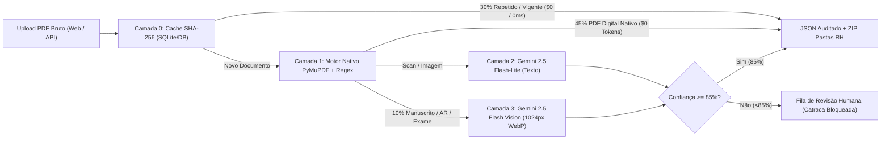

# 🛡️ Citadel AI — Document AI Factory & Blindagem Trabalhista B2B

> **Hack Garanhuns Tech 2026 | Desafio 3: Document AI Factory (Bernhoeft)**  
> Plataforma SaaS B2B 100% Web (e Motor API White-Label) para triagem inteligente, separação física de PDFs, auditoria de conformidade trabalhista (CLT / NRs / Súmula 331 TST) e proteção nativa de dados pessoais (LGPD) em hiperescala.

---

## 🎯 1. O Problema e a Proposta de Valor

Todos os dias, empresas contratantes, construtoras, indústrias e consultorias de Gestão de Riscos com Terceiros (como a **Bernhoeft**, que audita mais de **950.000 trabalhadores terceirizados**) recebem milhares de **"PDFs Frankenstein"**: arquivos únicos escaneados com 50 a 500 páginas misturadas contendo exames médicos (ASO), fichas de EPI sem assinatura, contratos, prontuários escritos à mão por médicos de plantão e comprovantes de AR dos Correios.

O **Citadel AI** transforma esse caos documental em conformidade instantânea:
1. **Ingestão e Corte Físico Automático (`.ZIP` para o RH):** Identifica onde começa e termina cada documento, recorta os PDFs fisicamente e organiza em árvore de pastas (`EMPRESA_CNPJ / FUNCIONARIO_CPF / TIPO_NOME_VALIDADE.pdf`).
2. **Radar de Passivo Trabalhista & Catraca (NRs / CLT):** Audita assinaturas, datas de vencimento e divergências cruzadas (NR-06, NR-07, NR-35), bloqueando preventivamente a liberação da catraca e calculando em Reais (`R$`) o passivo trabalhista evitado.
3. **Motor Forense para Manuscritos e AR dos Correios + Human-in-the-Loop:** Reconhece caligrafia cursiva médica e carimbos postais. Quando a confiança é `< 85%`, isola automaticamente na **Fila de Revisão Humana**.
4. **Escudo LGPD Visual e Textual (Privacy-by-Design):** Mascaramento automático de CPF, RG, CNPJ, E-mail, Telefone e CID no JSON + aplicação de **tarja preta direta nas páginas do PDF** com log de auditoria em CSV.
5. **Funil FinOps de 4 Camadas (94,6% de Economia de Tokens):** Resolve **75% do volume a custo zero de tokens** no motor nativo do servidor SaaS (Cache SHA-256 + PyMuPDF) antes de acionar o Gemini 2.5 Flash Vision.

---

## 🚀 2. Instruções de Execução (Quickstart)

### Pré-requisitos
- **Python 3.11+** (recomendado gerenciador `uv` ou `venv` padrão)
- Chave de API do Google Gemini (`GEMINI_API_KEY`) — *opcional para o modo de demonstração determinística com lote sintético pré-construído*.

### Passo a Passo (Windows / Linux / macOS)

1. **Clone o repositório:**
   ```bash
   git clone https://github.com/JairDevsen/Hackathon.git
   cd Hackathon
   ```

2. **Configure a variável de ambiente (opcional para chamadas reais ao Gemini 2.5 Flash):**
   Crie um arquivo `.env` na raiz (nunca versionado no Git):
   ```env
   GEMINI_API_KEY=sua_chave_aqui
   ```

3. **Instale as dependências e inicie o servidor:**
   - **No Windows (1 clique):**
     ```bat
     iniciar_sistema.bat
     ```
   - **Ou via terminal com `uv` / `venv`:**
     ```bash
     uv sync
     uv run uvicorn backend.main:app --host 0.0.0.0 --port 8000 --reload
     ```

4. **Acesse a Plataforma no Navegador:**
   - **Interface Web SaaS (Citadel AI):** `http://localhost:8000`
   - **Documentação Interativa da API (Swagger/OpenAPI):** `http://localhost:8000/docs`

5. **Execute a Suíte Automatizada de Testes Ponta a Ponta:**
   ```bash
   uv run python test_pipeline.py
   ```

---

## 🏗️ 3. Arquitetura do Sistema e Funil de Escala (FinOps)

Para suportar operações na escala de **950 mil colaboradores (~1,5 milhão de páginas/mês)** sem estourar custos de API de Visão Computacional, implementamos uma arquitetura de roteamento em **4 Camadas** no servidor SaaS:



| Camada do Funil | Tecnologia no Servidor SaaS | Volume Retido | Custo de Tokens IA | Latência Média |
| :--- | :--- | :---: | :---: | :---: |
| **Camada 0** | Deduplicação por Hash `SHA-256` + Vigência | **30%** | **US$ 0,00** | `< 2 ms` |
| **Camada 1** | Extração Nativa `PyMuPDF` + Heurística Local | **45%** | **US$ 0,00** | `~5 ms` |
| **Camada 2** | `Gemini 2.5 Flash-Lite` + Context Caching | **15%** | **US$ 0,01 / 1M tok** | `~450 ms` |
| **Camada 3** | `Gemini 2.5 Flash Vision` (1024px WebP = 258 tok) | **10%** | **258 tokens/pág** | `~1.200 ms` |

---

## ✅ 4. Capacidades Mínimas vs. Diferenciais Implementados

| Capacidade / Funcionalidade | Status | Onde Verificar no Código |
| :--- | :---: | :--- |
| **1. Ingestão Multipágina e Renderização de PDFs** | ✅ Funcional Ponta a Ponta | [`backend/ingestion.py`](backend/ingestion.py) |
| **2. Classificação Multiclasse (6 classes + Manuscrito/AR)** | ✅ Funcional Ponta a Ponta | [`backend/gemini_engine.py`](backend/gemini_engine.py) |
| **3. Extração Estruturada JSON (Datas, CPF, CNPJ, Assinatura)** | ✅ Funcional Ponta a Ponta | [`backend/schemas.py`](backend/schemas.py) / [`backend/gemini_engine.py`](backend/gemini_engine.py) |
| **4. Corte Físico de PDFs e Exportação `.ZIP` em Pastas de RH** | ✅ Funcional Ponta a Ponta | [`backend/ingestion.py`](backend/ingestion.py) (`/api/jobs/{id}/export-zip`) |
| **5. Anonimização LGPD (Texto + Tarja Preta no PDF + CSV)** | ✅ Funcional Ponta a Ponta | [`backend/anonymizer.py`](backend/anonymizer.py) (`/api/jobs/{id}/audit-csv`) |
| **6. Checkpointing Página a Página e Retomada de Falha (`/resume`)** | ✅ Funcional Ponta a Ponta | [`backend/database.py`](backend/database.py) (`/api/jobs/{id}/resume`) |
| **7. Governança Human-in-the-Loop (`Confiança < 85%`)** | ✅ Funcional Ponta a Ponta | [`backend/main.py`](backend/main.py) (`/api/documents/{id}/approve`) |
| **8. Checklist de Mobilização / Catraca e Conformidade NRs** | ✅ Funcional Ponta a Ponta | [`backend/gemini_engine.py`](backend/gemini_engine.py) |

---

## ⚠️ 5. Registro de Premissas, Limitações Atuais e Riscos (Transparência Técnica)

Em conformidade com as boas práticas de engenharia exigidas pelo edital do **Hack Garanhuns Tech 2026**, documentamos abaixo as premissas do MVP, suas limitações conhecidas e o plano de evolução para produção:

### 5.1. Premissas Assumidas no MVP
1. **Dados 100% Sintéticos para Segurança:** Por conformidade rigorosa com a LGPD, nenhum documento real de trabalhador foi utilizado ou exposto no repositório. Todo o lote de demonstração (incluindo caligrafia médica simulada e carimbo de AR dos Correios) é gerado programaticamente por [`backend/sample_generator.py`](backend/sample_generator.py).
2. **Fallback Determinístico para Estabilidade de Demo:** Caso a rede Wi-Fi do evento oscile ou a variável `GEMINI_API_KEY` não esteja configurada, o motor possui um fallback determinístico calibrado para o lote de demonstração, garantindo que todas as funcionalidades de pós-processamento (corte de PDF, anonimização regex, banco SQLite, ZIP e CSV) possam ser auditadas offline.
3. **Limiar de Confiança em 85% (`0.85`):** Assumimos o corte de `85%` de confiança para separação entre aprovação automática e fila de revisão humana com base em benchmarks de automação documental trabalhista.

### 5.2. Limitações Atuais do Protótipo (Onde quebraria em 10x de carga hoje)
1. **Banco de Dados Local (`SQLite`):** No MVP utilizamos SQLite (`jobs_state.db`), que sofre contenção de escrita (`database locked`) sob alta concorrência de múltiplos uploads simultâneos.
2. **Processamento Síncrono por Requisição:** Lotes gigantes (ex: um único PDF com 1.000 páginas escaneadas) processados na mesma thread HTTP podem sofrer timeout de gateway se não estiverem em fila assíncrona.
3. **Validação Externa de Assinatura ICP-Brasil / CRM:** Atualmente validamos a presença visual/textual da assinatura e do CRM no documento, sem consultar em tempo real a API do CFM ou cadeia criptográfica ICP-Brasil.

### 5.3. Riscos Conhecidos e Mitigação Implementada
- **Risco de Falso Positivo em Documento Médico (Alucinação de LLM):** Mitigado via **Human-in-the-Loop obrigatório** para documentos manuscritos ou com confiança `< 85%`, bloqueando preventivamente a liberação na catraca.
- **Risco de Vazamento de Dados Sensíveis de Saúde (Art. 11 LGPD):** Mitigado via variáveis de ambiente fora do código, mascaramento por Regex e redação visual (tarja preta) diretamente nos bytes do PDF exportado.

### 5.4. Próximos Passos para Produção Real (Roadmap Pós-Hackathon)
1. **Fila Assíncrona e Banco Distribuído:** Migrar de SQLite para **PostgreSQL** e introduzir workers **Celery + Redis** para processamento paralelo de páginas em background.
2. **Armazenamento Cloud Seguro:** Substituir armazenamento em memória/disco local por buckets criptografados (**Google Cloud Storage / AWS S3**) com URLs assinadas temporárias.
3. **Piloto de Calibragem (30 dias):** Validar as regras de divergência trabalhista com um lote histórico anonimizado de uma operação real de Gestão de Terceiros (ex: Bernhoeft).

---

## 👥 6. Equipe e Divisão de Responsabilidades

- **Lucas (Líder de Projeto, Produto & Estratégia B2B/FinOps):** Arquitetura de negócio SaaS, modelagem FinOps de 4 camadas e regras de conformidade trabalhista.
- **Jair & Davi (Squad 1 — Frontend & UX):** Interface web responsiva Citadel AI, visualizador lado a lado, painel de revisão humana e experiência de usuário.
- **Luis Miguel, Jamerson & Lennarth (Squad 2 — Backend & IA Core):** Pipeline FastAPI, motor PyMuPDF + Gemini 2.5 Flash, corte físico de PDFs, exportação `.ZIP` e checkpointing SQLite (`/resume`).
- **Thaynara (Squad 3 — Segurança LGPD, Dados Sintéticos & QA):** Motor de anonimização PII (`anonymizer.py`), tarja preta em PDFs, trilha de auditoria CSV e testes integrados (`test_pipeline.py`).
